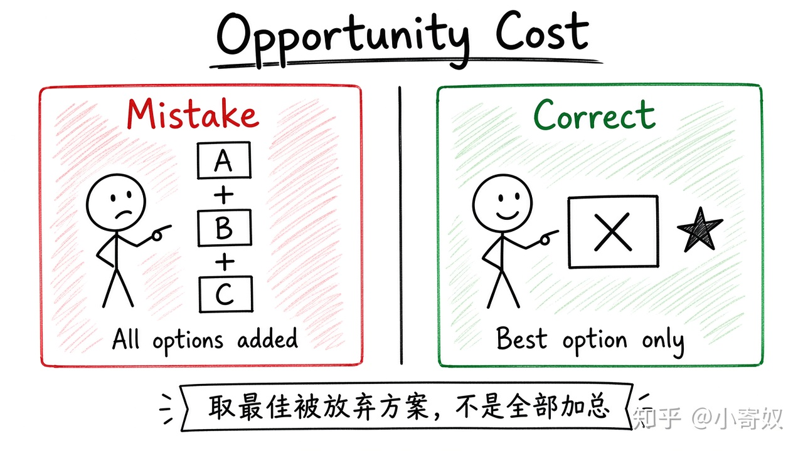

# 01｜稀缺性、权衡与机会成本

- 所属单元：Unit 01
- 建议用时：15 分钟
- 本节只解决：**资源有限时，怎样识别一个选择真正放弃了什么？**
- 导航：[返回单元首页](README.md) · [下一节](02_sunk_cost_marginal_analysis.md)

## 0～2 分钟：主动回忆

先写一句你目前的判断（可以是「不知道」）：

> 资源有限时，怎样识别一个选择真正放弃了什么？

## 本节术语

| 中文术语 | English | 缩写 | 通俗解释 |
|---|---|---|---|
| 稀缺性 | Scarcity | 无通用缩写 | 资源不足以同时满足所有有价值用途，因此必须选择。 |
| 权衡 | Trade-off | 无通用缩写 | 为了得到更多某一目标，需要减少或放弃另一目标。 |
| 机会成本 | Opportunity Cost | OC | 作出选择时，**最佳被放弃方案**的价值。 |

> 第一次出现记住「中文（English, 缩写）」；无公认缩写就写「无通用缩写」，不要自造。

## 2～9 分钟：核心内容

微观经济学从稀缺性（Scarcity，无通用缩写）开始：目标多于可同时使用的资源。同一段时间不能既加班又学习又休息，所以必须权衡（Trade-off，无通用缩写）。

权衡只说明「多一点 A，通常少一点 B」。机会成本（Opportunity Cost, OC）再进一步：在未选方案里，取出**价值最高的那一个**。它不是所有放弃项之和，也不一定是现金——健康、精力、未来效率都可能计入。



固定分析顺序即可（不必另起第二套流程）：决策主体 → 稀缺资源 → 真实可选方案 → 未选方案排序 → 最佳被放弃方案。

## 9～12 分钟：最小例子

今晚只有 2 小时：A 加班得 400 元，B 学习微观，C 休息运动。若选 B，不能默认 OC=400 元。若已极度疲劳，C 的完整价值可能更高——那时机会成本是 C。

## 12～14 分钟：你来做

写出过去 7 天的一个三选一：

```text
稀缺资源：
三个方案：
最终选择：
最佳被放弃方案：
现金部分：
非现金部分：
```

## 14～15 分钟：费曼复述

> 稀缺性迫使我进行 ______；机会成本是 ______，而不是 ______。

## 适用边界

机会成本依赖目标、信息与约束；它帮助比较，但不给出人人相同的答案。

## 完成证据

- [ ] 能说出本节英文术语与缩写
- [ ] 完成最小例子
- [ ] 保留了自己的判断过程
- [ ] 一句话复述与疑问已写入[工作簿](../workbook.md)
