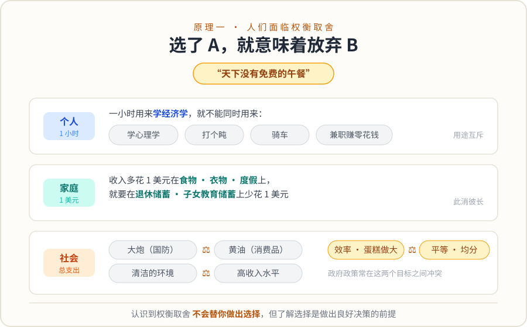

# 01｜为什么“免费”的晚上也很贵？

> ⏱ 核心 10–15 分钟 ｜ 一个问题 · 一张图 · 一道题 · 一分钟复述

**本课问题：资源只能用一次时，“没花钱”的选择到底贵在哪里？**

先想象今晚。19:00 到 21:00，你可以学经济学、接一单兼职、或者运动休息。假设课程免费——听起来“没有成本”。**这是真的吗？10 分钟后你自己就能算出来。**

## 先看一张图

图里只说了一件事：**同一条两小时，三个方案谁都能把它占满，但谁也不能跟别人分着用。** 选了 A，B 和 C 就消失了——不是它们不存在，是你的这段时间不存在了。

## 稀缺不是穷，是“用了就不能再用”

| 中文 | 原始英文 | 一句话意思 |
|---|---|---|
| 稀缺性 | Scarcity | 无通用缩写。增加一种用途，就必须放弃另一种用途。 |
| 权衡 | Trade-off | 无通用缩写。多得一个目标，往往就少得另一个目标。 |

**稀缺性（Scarcity）和有钱没钱无关。** 钱、时间、注意力、算力、测试车的可用里程，都可能稀缺。判断标准只有一条：多用在这里，是不是就得少用在那里？空闲的显卡不必然“免费”——它也许能出租，也许跑任务要耗电；确认没有别的用途，它这段时间的代价才可能很低（下一课把这个代价算出来）。

权衡（Trade-off）也不要求你把一切都换算成人民币。睡眠带来的健康价值很难标价，但仍然要参与比较。经济学的要求是**不漏掉有价值的替代用途**，不是替每种人生选择编一个精确价格。

## 一道题自测

团队有一台测试车，今晚可以：① 给项目 A 采数据；② 租给兄弟团队收租金；③ 停在车库。哪句话能说明这台车今晚是“稀缺”的？

展开答案

选了①就失去②的租金，选了②就失去①的数据——**用途互斥，这就是稀缺**，跟买车当年花了多少钱无关。如果今晚兄弟团队根本不需要车、项目 A 也暂停，③是唯一可行用途，那这段时间的代价才真的接近零。判断稀缺不看资源总量，看用途之间是否互斥。

## 接到你的工作（可选，约 2 分钟）

算力、标注人力、车队测试窗口，全是“用了就不能再用”的资源。下次排期评审，试着把“这个任务占了什么稀缺资源、挤掉了谁”说出来，比只说“这个任务很重要”有信息量得多。

## 一分钟讲给别人听

用“今晚两小时”向朋友解释：什么是稀缺，为什么免费课程也不免费。讲不清“用了就不能再用”，就回到图再看一遍。

**本课一句话：稀缺 = 用了就不能再用；权衡 = 选了就要放弃。**

教材主题索引：曼昆《经济学原理·微观经济学分册》第 1 章“人们面临权衡”。本页例子为自编。

[返回单元首页](README.md) · [下一课：选了 A，真正放弃的是什么？](02_opportunity_cost.md)

把自测的原始答案和复述卡点记入[课程工作簿](../workbook.md)。
