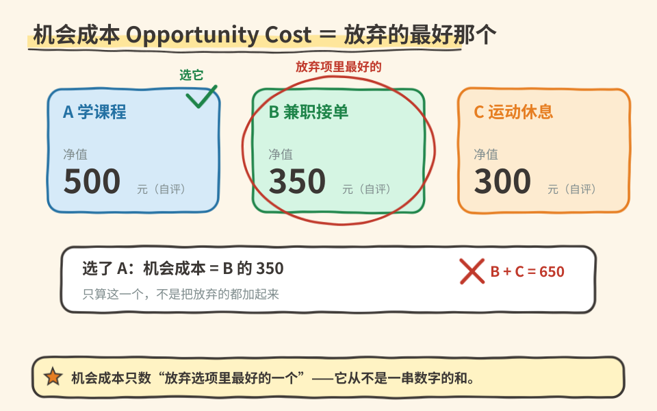

# 02｜原理二：某种东西的成本是为了得到它所放弃的东西

> ⏱ 核心 10–15 分钟 ｜ 对应教材：第 1 章 1.1.2 节
> 一个问题 · 一张图 · 一道题 · 一分钟复述

**本课问题：上一年大学，成本到底是多少？为什么把账单加总起来是错的？**

## 先看一张图

## 原文精读

**1. 问题的由来。** 由于人们面临权衡取舍（原理一），做决策就需要比较可供选择的行动方案的成本与收益。但在许多情况下，**某种行动的成本并不是一目了然的**。

**2. 教材的例子：是否上大学。** 上大学的主要收益是丰富了知识，并且一生中都拥有更好的工作机会。但成本是什么呢？直觉的回答是：把学费、书籍、住宿和伙食的钱加总起来。教材指出，**这一总和并不真正代表你上一年大学所放弃的东西**，它存在两个问题：

- **问题①：它算进了一些并不是上大学真正成本的项目。** 即使你离开了学校，你也需要有睡觉的地方、需要吃饭。只有在大学的住宿和伙食比其他地方贵时，**贵出来的那一部分**才是上大学的成本。
- **问题②：它忽略了上大学最大的成本——你的时间。** 当你把一年的时间用于听课、读书和写论文时，你就不能把这段时间用于工作。对大多数学生而言，**为了上大学而不得不放弃的收入，是接受教育的最大单项成本**。

**3. 核心定义。**

| 术语 | 教材定义 |
|---|---|
| 机会成本（Opportunity Cost） | 为了得到某种东西所必须放弃的东西。 |

当做出任何一项决策时，决策者都应该认识到每一种可能的行动所带来的机会成本。

**4. 教材的对照例子：大学运动员。** 那些大学里的运动员如果退学转而从事职业运动，每年能赚上几百万美元。他们深深认识到自己上大学的机会成本极高，所以通常认为不值得花费这些成本来获得上大学的收益——这一点儿也不奇怪。

**5. 怎么用它。** 机会成本不等于“花的钱”。它包含两类：

- **货币性机会成本**：直接多花出去的钱（学费、书籍、贵出来的食宿费）；
- **非货币性机会成本**：放弃的时间、收入、休息、其他可能性。

决策时漏掉第二类，是“账单思维”代替“机会成本思维”的典型错误。

## 一道题自测

（教材“即问即答”原题）举出一个既有货币性机会成本、又有非货币性机会成本的行动的例子，并分别指出两类成本是什么。

展开参考思路

示例（自编）：脱产读研三年。货币性机会成本：学费、比合租更贵的宿舍费等直接支出。非货币性机会成本：三年工资收入、三年的工作经验与晋升、以及这段时间本可用于其他方向的可能。注意：租房费用不能全算——不读书你也要住房，只有“贵出来的部分”才计入，这正是上大学例子里问题①的迁移。

## 接到你的工作（可选，约 2 分钟）

团队评估“要不要自研一个内部工具”时，报价单上只有开发人力成本。用机会成本重算一遍：这批人三个月不做业务需求，放弃的业务收益是多少？那往往是最大的一项——和“上大学最大的成本是时间”是同一个结构。

## 一分钟讲给别人听

用“上大学”向朋友解释：① 为什么学费加生活费不是全部成本；② 哪两笔账要修正；③ 机会成本的准确定义。能讲清“最大的成本是放弃的收入”，这课就过关了。

**本课一句话：一个行动的成本，不是账单上的数字，而是你为了它所放弃的东西。**

教材主题索引：曼昆《经济学原理·微观经济学分册（第 8 版）》第 1 章 1.1.2 节。本课例子除标注“自编”外均出自教材。

[上一课：原理一——权衡取舍](01_scarcity_tradeoff.md) · [返回单元首页](README.md) · [下一课：已经投入很多，还要继续吗？](03_sunk_cost.md)

把自测的原始答案和复述卡点记入[课程工作簿](../workbook.md)。
