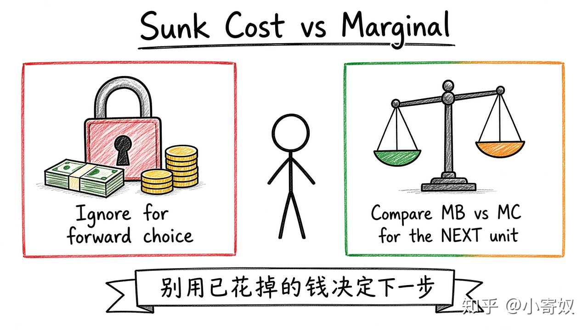

# 02｜沉没成本与边际分析

- 所属单元：Unit 01
- 建议用时：15 分钟
- 本节只解决：**过去投入很多时，当前决策到底应该比较什么？**
- 导航：[上一节](01_scarcity_opportunity_cost.md) · [返回单元首页](README.md) · [下一节](03_incentives_trade_markets.md)

## 0～2 分钟：主动回忆

> 过去投入很多时，当前决策到底应该比较什么？

## 本节术语

| 中文术语 | English | 缩写 | 通俗解释 |
|---|---|---|---|
| 沉没成本 | Sunk Cost | SC | 已发生且当前决定无法收回或改变的成本。 |
| 边际收益 | Marginal Benefit | MB | 再增加一单位行动的额外收益。 |
| 边际成本 | Marginal Cost | MC | 再增加一单位行动的额外成本。 |

## 2～9 分钟：核心内容

沉没成本（Sunk Cost, SC）可以复盘，但不能单独证明「现在必须继续」。当前只比较从此刻起的新增收益与新增成本。

最小规则：MB≥MC 时，增加这一单位可能值得；MB<MC 时，停止增加。

注意：「已经支付」≠「全部沉没」。3000 元课程若可退 1000，则不可退的 2000 是 SC，可退的 1000 仍会被当前决定改变，应纳入比较。

## 9～12 分钟：最小例子

每多训练 1 小时，MB 为 10、7、4，MC 为 3、4、5。前两小时 MB≥MC，第三小时 MB<MC → 只按这些信息，训到第 2 个额外小时。

## 12～14 分钟：你来做

项目已投入 6 个月。继续一个月：新增收益 5 万、新增成本 8 万；停止可转做净收益 4 万的新项目。写出当前比较——不要把过去 6 个月再加进去。

## 14～15 分钟：费曼复述

> 沉没成本是 ______；当前应比较未来的 ______ 与 ______，并考虑最佳替代用途。

## 适用边界

若风险、合同、声誉、未来选择权会被当前决定改变，它们就不是沉没成本，仍要纳入未来比较。

## 完成证据

- [ ] 能说出本节英文术语与缩写
- [ ] 完成最小例子
- [ ] 保留了自己的判断过程
- [ ] 一句话复述与疑问已写入[工作簿](../workbook.md)
