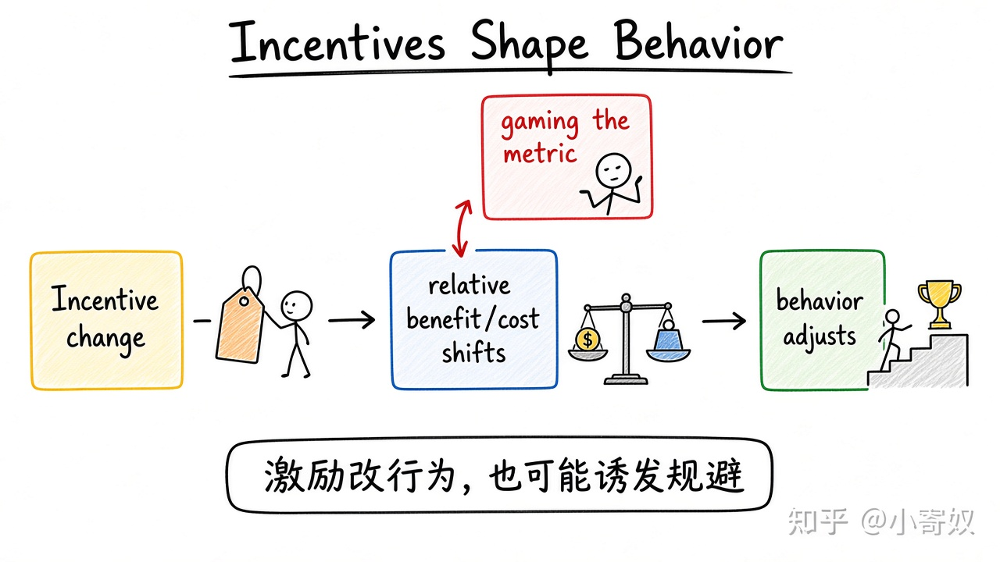

# 03｜激励、贸易与市场协调

- 所属单元：Unit 01
- 建议用时：15 分钟
- 本节只解决：**没有总指挥时，人的行为和市场资源为什么仍会发生调整？**
- 导航：[上一节](02_sunk_cost_marginal_analysis.md) · [返回单元首页](README.md) · [下一节](04_models_ceteris_paribus.md)

## 0～2 分钟：主动回忆

> 没有总指挥时，人的行为和市场资源为什么仍会发生调整？

## 本节术语

| 中文术语 | English | 缩写 | 通俗解释 |
|---|---|---|---|
| 激励 | Incentive | 无通用缩写 | 改变某种行为相对收益或相对成本的因素。 |
| 专业化 | Specialization | 无通用缩写 | 把更多资源集中到相对擅长或机会成本较低的活动。 |
| 市场 | Market | 无通用缩写 | 买方和卖方进行交换并形成价格与数量的机制或场所。 |

## 2～9 分钟：核心内容

激励（Incentive，无通用缩写）通过改变相对收益或成本影响行为：奖金、税收、罚款、晋升、等待、风险都是。人会响应激励，也可能规避——考核指标 ≠ 真实目标。

专业化（Specialization，无通用缩写）把资源集中到相对适合的活动，再交换其他成果；总产出可能上升，但分配与转换成本要单独看。

市场（Market，无通用缩写）用价格连接分散决策：短缺时价格上涨，既传递信息，也改变节约与扩产激励。

## 9～12 分钟：最小例子

只按「代码提交次数」奖励，提交数可能涨，但也可能被拆分提交、牺牲质量。问三句就够：谁的 MB/MC 变了？指标能否被操纵？有没有替代行为？

## 12～14 分钟：你来做

选一个工作激励，写出：预期行为、一个规避方式、一个副作用；再写一种靠分工提高团队成果的方式。

## 14～15 分钟：费曼复述

> 激励改变人的 ______；专业化和交换可能提高 ______；市场价格同时传递 ______ 并提供 ______。

## 适用边界

市场协调依赖产权、合同、信息与竞争。价格未含外部成本、或存在市场势力时，结果可能失灵。

## 完成证据

- [ ] 能说出本节英文术语与缩写
- [ ] 完成最小例子
- [ ] 保留了自己的判断过程
- [ ] 一句话复述与疑问已写入[工作簿](../workbook.md)
