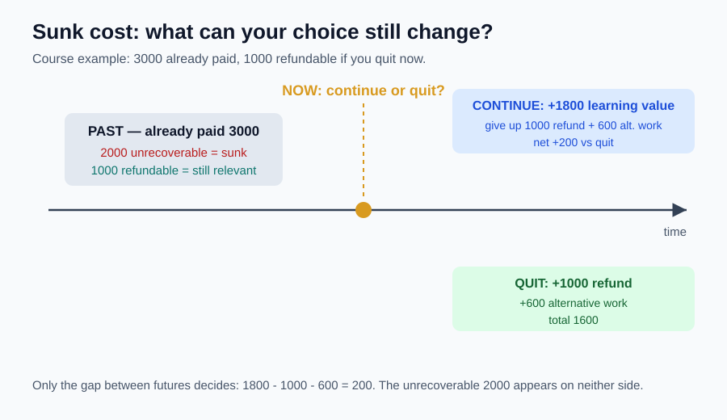

# 03｜已经投入很多，还要继续吗？

> ⏱ 核心 10–15 分钟 ｜ 一个问题 · 一张图 · 一道题 · 一分钟复述

**本课问题：面对“来都来了”，怎样把过去的投入和未来的得失分开？**

先修回顾：机会成本盯着“现在放弃什么”。这一课把比较的起点钉死在**此刻**——从现在起，不同选择会改变什么？改不了的，就先请出决策桌。

## 先看一张图

图的关键在中间那个点。**过去那 3000 元里，2000 元已经拿不回来——它是沉没的；1000 元还能退——它仍然活着。** 决策只看两个未来的差额。

## 已经付款 ≠ 全部沉没

| 中文 | 原始英文 | 一句话意思 |
|---|---|---|
| 沉没成本 | Sunk Cost | 无统一通用缩写；本课不写 SC。已经发生，且当前选择无法收回或改变的成本。 |

自编案例：你为课程付了 3000 元，已学 20 小时。现在退出还能退 1000 元；继续学完要再花 10 小时，预计新增学习价值 1800 元等值；同样 10 小时用于最佳替代任务可净得 600 元。

逐项问一句：**当前选择能改变它吗？**

→ 已学的 20 小时：退不回 → 沉没。学到的能力继续或退出都保留，不能偏心只算给“继续”。

→ 不可退的 2000 元：不受当前决定影响 → 沉没。

→ 可退的 1000 元：退出拿得到，继续就失去 → **仍是相关成本**。

以退出为基准，继续的额外得失：

$$
1800-1000-600=200\text{ 元等值}。
$$

给定估值下，继续多 200。若新增学习价值降到 1500，差额变 −100，退出更好。**忽略沉没成本可能导向继续，也可能导向退出**——它只是要求结论由未来差异支撑。

再换一种检查：继续得 1800；退出得退款 1000 加替代收益 600，共 1600。还是差 200。把历史 3000 同时放两边会抵消；只放进“继续”一侧，就是在人为惩罚继续。

**两个极端都错。**“投都投了，必须回本”把历史账单当成未来收益；“既然是沉没就彻底不看历史”也不对——过去的失败暴露了能力或市场问题，那是**预测未来的证据**。要排除的是改不了的历史成本，不是历史带来的信息。

## 一道题自测

门票花了 500 元，现在可退 200 元；去参加活动还要交通费 80 元，占用时间的最佳替代价值 120 元；你对活动体验的估值是 350 元。去，还是退？

展开答案与成本分类

不可退的 300 元是沉没成本。去，就放弃退款 200、多花交通费 80、牺牲时间价值 120，相关成本合计 400；体验价值只有 350，**少 50，退票更好**。换个算法：去的未来净价值 $350-80=270$；退票的退款加替代活动 $200+120=320$，还是差 −50。历史票价 500 不许再扣一次。

## 接到你的工作（可选，约 2 分钟）

模型已经训练了一周，要不要继续调？已花的算力改不了，别让它替你投票。真正的问题：再花一天，预期提升值不值这一天能干的其他事？另外，股票买入价通常不影响资产未来的现金流——但交易费用和风险暴露会改变持有与卖出的差异，别把一句“忽略沉没成本”当成完整投资分析。

## 一分钟讲给别人听

用退款案例讲清：历史支出怎样分成可收回与不可收回；为什么可退的 1000 元必须算进去。

**本课一句话：只问“现在还能改变什么”——改不了的是沉没，改得了的才进决策。**

教材主题索引：曼昆第 1 章边际决策前的成本观念；数值为自编。

[上一课](02_opportunity_cost.md) · [返回单元首页](README.md) · [下一课：“再做一点”，做到哪一单位为止？](04_marginal_analysis.md)

把自测的原始答案和复述卡点记入[课程工作簿](../workbook.md)。
