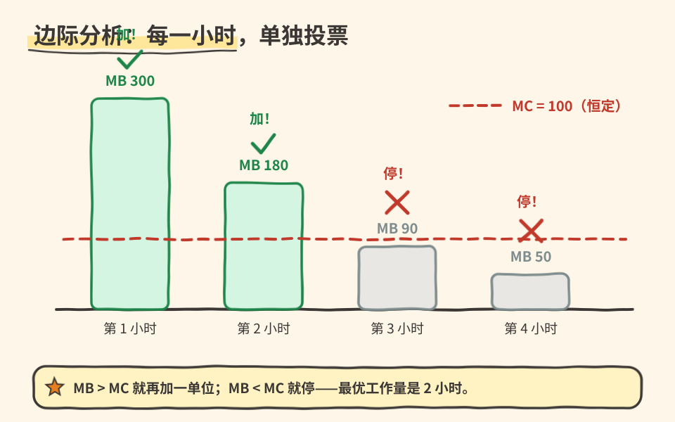

# 04｜“再做一点”，做到哪一单位为止？

> ⏱ 核心 10–15 分钟 ｜ 一个问题 · 一张图 · 一道题 · 一分钟复述

**本课问题：决定“继续做多大”时，应该盯着哪个数字？**

先修回顾：沉没成本帮你清理了过去。现在面对未来，问题从“做不做”升级成“**做多少**”。答案是经济学最顺手的工具：一次只问下一单位。

## 先看一张图

每一小时单独投票：**柱高过线，就加；矮过线，就停。** 注意第 3 小时——它不是“坏”，只是不值。

## 术语先翻译成人话

| 中文 | 原始英文 | 一句话意思 |
|---|---|---|
| 边际分析 | Marginal Analysis | 无通用缩写。比较行动再多一单位带来的额外得失。 |
| 边际收益 | Marginal Benefit | MB。再多一单位行动带来的额外收益。 |
| 边际成本 | Marginal Cost | MC。再多一单位行动带来的额外成本，含放弃的其他用途。 |

“边际”不是“不重要”，是**变化的边缘**。这里的“单位”可以是一小时、一次实验、一辆测试车，不需要无限小，更不需要微积分。

## 完整算一次：四小时里选几小时？

自编案例：一个验证任务可逐小时加投入。每小时新增成本都是 100 元等值（工资、电费、时间的最佳替代用途已算全，不许再加一遍）。明显问题先被解决，所以收益递减：

| 再投入第几小时 | 该小时 MB | 该小时 MC | 该小时净增益 | 累计净增益 |
|---:|---:|---:|---:|---:|
| 1 | 300 | 100 | 200 | 200 |
| 2 | 180 | 100 | 80 | 280 |
| 3 | 90 | 100 | −10 | 270 |
| 4 | 50 | 100 | −50 | 220 |

第 1、2 小时各自值得，第 3 小时开始拖低总量，**最佳规模是两小时**。

两个陷阱，都很多人踩：

→ **“累计还是正的，所以第 4 小时也值得做。”** 错。四小时累计净收益仍是 220，但决定第 4 小时的是它自己的 50 对 100，不是前面赚了多少。

→ **“最优点就是 MB＝MC。”** 有条件。行动可连续微调、函数平滑时，等式才用于求解。按整小时选，只需要“最后一个接受的小时增益为正、下一个为负”，不必刚好相等。

还有一个隐藏前提：收益不会突然跳升。假如前两小时在装工具、第三小时才能跑通系统，见第一小时没收益就停手就错了——**把不可分割的三小时当作一个方案，比较整个方案的增量**。局部规则替代不了对可选方案的理解。

## 一道题自测

另一个任务每小时 MC 为 150，逐小时 MB 依次为 400、200、140、80。最佳投入几小时？累计净增益是多少？

展开答案

第 1 小时 400＞150，加；第 2 小时 200＞150，加；第 3 小时 140＜150，停。**最佳两小时**，累计净增益 $(400-150)+(200-150)=300$。第 3 小时的 140 并非“没有价值”，只是不值它的成本。

## 接到你的工作（可选，约 2 分钟）

“模型再调一周”“数据再标一万条”都是边际问题。别问“这个项目值不值得做”，问“**下一周**的预期提升，值不值这一周的其他用途”。答案通常比前者清晰得多。

## 一分钟讲给别人听

用柱状图讲：为什么第 3 小时不值得做？为什么“累计为正”不能替下一单位投票？

**本课一句话：决定规模的，是下一单位的得失，不是已经累积的成绩。**

教材主题索引：曼昆第 1 章“理性人考虑边际量”。数值为自编。

[上一课](03_sunk_cost.md) · [返回单元首页](README.md) · [下一课：改一个指标，为什么人会变？](05_incentives.md)

把自测的原始答案和复述卡点记入[课程工作簿](../workbook.md)。
