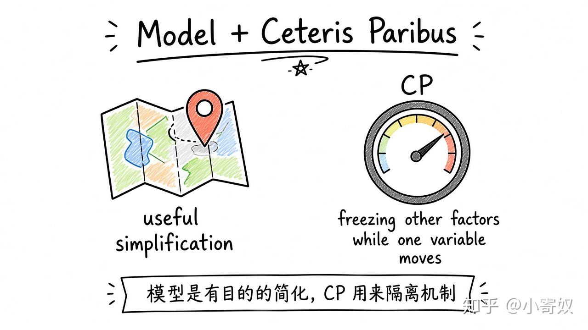

# 04｜经济模型与其他条件不变

- 所属单元：Unit 01
- 建议用时：15 分钟
- 本节只解决：**经济模型为什么可以故意忽略大量现实细节？**
- 导航：[上一节](03_incentives_trade_markets.md) · [返回单元首页](README.md) · [下一节](05_circular_flow_ppf.md)

## 0～2 分钟：主动回忆

> 经济模型为什么可以故意忽略大量现实细节？

## 本节术语

| 中文术语 | English | 缩写 | 通俗解释 |
|---|---|---|---|
| 经济模型 | Economic Model | 无通用缩写 | 为回答特定问题而有目的地简化现实的分析框架。 |
| 其他条件不变 | Ceteris Paribus | CP | 分析一个变量变化时，暂时把其他相关因素视为不变。 |

## 2～9 分钟：核心内容

经济模型（Economic Model，无通用缩写）不是现实的完整复制，而是为回答特定问题保留关键机制。地图不画每棵树仍能导航。

其他条件不变（Ceteris Paribus, CP）是为了隔离一个机制：研究「自身价格如何影响购买量」时，可暂时固定收入、偏好与相关商品价格——不是声称现实真的静止。

评价模型只问四句：要回答什么？保留了什么？忽略了什么？忽略项会不会改结论方向？

## 9～12 分钟：最小例子

研究油价上涨对燃油车使用量时，CP 可暂时固定收入与公共交通。但若同期地铁开通，忽略它就可能误判油价作用。

## 12～14 分钟：你来做

为「AI 工具是否提高工程效率」写最小模型：结果变量、关键解释变量、暂时固定的三个因素、一个不能忽略的因素。

## 14～15 分钟：费曼复述

> 经济模型是为了 ______ 而简化；CP 的作用是暂时 ______，以隔离一个机制。

## 适用边界

简单不等于错误。若被忽略变量正是关键原因，就要扩展或换模型。

## 完成证据

- [ ] 能说出本节英文术语与缩写
- [ ] 完成最小例子
- [ ] 保留了自己的判断过程
- [ ] 一句话复述与疑问已写入[工作簿](../workbook.md)
