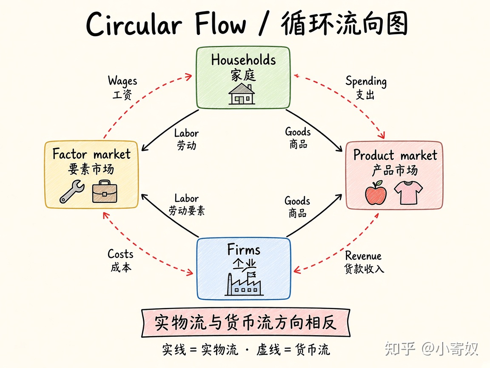
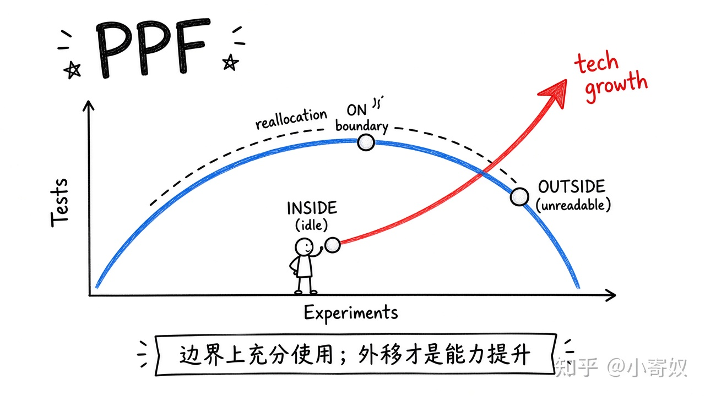

# 05｜循环流向图与生产可能性边界

- 所属单元：Unit 01
- 建议用时：15 分钟
- 本节只解决：**怎样用两张图表达经济主体联系和资源约束？**
- 导航：[上一节](04_models_ceteris_paribus.md) · [返回单元首页](README.md) · [下一节](06_micro_macro_positive_normative.md)

## 0～2 分钟：主动回忆

> 怎样用两张图表达经济主体联系和资源约束？

## 本节术语

| 中文术语 | English | 缩写 | 通俗解释 |
|---|---|---|---|
| 循环流向图 | Circular-flow Diagram | CFD | 家庭、企业、产品市场与要素市场之间实物流与货币流的简化图。 |
| 生产可能性边界 | Production Possibilities Frontier | PPF | 给定资源与技术时，两种产出的最大可达组合边界。 |
| 机会成本 | Opportunity Cost | OC | 作出选择时，最佳被放弃方案的价值。 |

## 2～9 分钟：核心内容

循环流向图（Circular-flow Diagram, CFD）：家庭提供要素获收入并买产品；企业买要素、卖产品。实物流是家庭 → 要素市场 → 企业（劳动），以及企业 → 产品市场 → 家庭（商品）；**货币流与实物流方向相反**。

生产可能性边界（Production Possibilities Frontier, PPF）：边界上=资源充分使用；边界内=闲置/低效；边界外=当前不可达。沿边界移动是重配资源；整条外移才是资源增加或技术进步。PPF 斜率绝对值表示生产横轴产品的机会成本。

## 9～12 分钟：最小例子

从「2 个实验、9 批测试」移到「4 个实验、7 批测试」：

$$
OC_{实验}=\frac{|7-9|}{|4-2|}=1
$$

单位是「批测试/个实验」。只写数字 1 不完整，必须说明放弃的是什么。

## 12～14 分钟：你来做

画一张横轴「算法实验」、纵轴「系统测试」的 PPF，标出边界上/内/外各一点，并写一种使边界外移的变化。

## 14～15 分钟：费曼复述

> CFD 表示 ______ 之间的实物与货币流；PPF 表示 ______，其斜率绝对值反映 ______。

## 适用边界

PPF 只处理两类产出并假定资源技术给定；质量差异、协调成本与多产品关系可能需要更复杂模型。

## 完成证据

- [ ] 能说出本节英文术语与缩写
- [ ] 完成最小例子或计算
- [ ] 保留了自己的判断过程
- [ ] 一句话复述与疑问已写入[工作簿](../workbook.md)

## 学习笔记

> 记录时间：2026-10-22 · 对应主线课：05｜循环流向图与生产可能性边界

开篇先写判断：**不知道**——诚实起点，读完再对照。

### 疑问：要素市场的要素是什么？

**要素**＝生产要素（factors of production）：劳动、资本、土地、企业家才能等，是生产商品/服务时投入的资源。

入门用的循环流向图常以**劳动**为代表：家庭把劳动卖到要素市场，企业来买，并支付工资。

易错点：把「要素」听成「重要因素」或「市场要素」。这里专指可投入生产的资源，不是「关键影响因素」的口语义。

### 疑问：两种产出是什么？

PPF 故意只画**两种产出**（二维图）：横轴一种、纵轴另一种。不是说现实只有两种产品，而是为回答「给定资源时最多能到哪」先做有目的的简化。

文中例子：横轴「算法实验」、纵轴「系统测试」。边界上每个点＝在资源与技术给定、且充分使用时，这对数量的最大可达组合（如 2 实验配 9 测试）。边界内是闲置/低效；边界外是当前做不到。

易错点：以为「两种」是硬性规定。课堂用二维是为了能画、能算斜率；多产品时可用更高维，或先挑两个代表任务再画。

### 疑问：circular flow 英文对应中文？图是否正确？实物流与货币流反向指什么？

| English | 中文 |
|---|---|
| Households | 家庭 |
| Firms | 企业 |
| Factor market | 要素市场 |
| Product market | 产品市场 |
| Labor / Goods | 劳动 / 商品（实物流） |
| Wages / Spending / Revenue / Costs | 工资 / 支出 / 货款收入 / 成本（货币流） |

旧版配图流向有误（例如支出不应指向要素市场）。正确回路：

- **实物流**：家庭 → 要素市场 → 企业（劳动）；企业 → 产品市场 → 家庭（商品）
- **货币流反向**：企业 → 要素市场 → 家庭（工资）；家庭 → 产品市场 → 企业（货款）

「方向相反」＝同一笔交易里，东西往这边走，钱往对面走：你付出劳动，拿到工资；企业交出商品，收回货款。

### 疑问：PPF 一定针对两种任务吗？边界点是否＝实验次数对应测试次数？

课堂二维 PPF **画成**两种任务/产出，方便看位置与斜率；不是现实只能二选一。文中边界上的点，正是在资源一定、充分使用时，「实验次数」与「测试次数」的最大可达组合；沿边界移动是重配，整条外移才是能力变大。

### 费曼复述（自填）

> CFD 表示 **家庭、企业、要素市场、产品市场** 之间的实物与货币流；PPF 表示 **在给定资源和技术的情况下，两种产出的最大可能的组合**，其斜率绝对值反映 **机会成本（多增加 1 单位横轴产出，大约放弃多少纵轴产出）**。

### 简要点评

- 开篇「不知道」很好：主动回忆先占位，再读机制。
- 卡点在术语所指（要素、两种产出）和 CFD 图是否与文字同向——图必须以正确回路为准。
- PPF 例子与 01 的机会成本接上：斜率把「放弃了什么」画成几何量。
