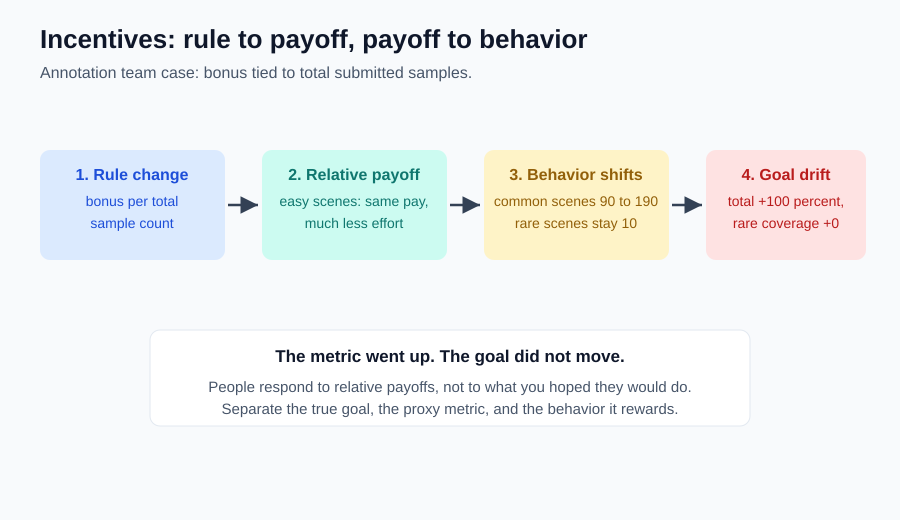

# 05｜改一个指标，为什么人会变？

> ⏱ 核心 10–15 分钟 ｜ 一个问题 · 一张图 · 一道题 · 一分钟复述

**本课问题：激励怎样改变人的选择，为什么“指标涨了”常常不等于“目标成了”？**

先修回顾：上一课比较新增得失。激励之所以能改变行为，正因为它改了相对得失——**不是因为人突然变勤奋或变自私**。

## 先看一张图

四个环节：规则 → 相对得失 → 行为 → 结果对照目标。**大多数“激励翻车”在第 4 环才被发现。**

## 一个真实感很强的自编案例

| 中文 | 原始英文 | 一句话意思 |
|---|---|---|
| 激励 | Incentive | 无通用缩写。改变某种行为相对收益或相对成本的因素。 |

标注团队想要更多罕见场景，管理者把奖金绑到“提交样本总数”。调整前一周：普通场景 90 个、罕见场景 10 个。调整后：普通 190 个、罕见**仍然 10 个**。总数从 100 涨到 200，+100%；罕见场景占比却从 10% 掉到 5%。

第一反应别是“员工没责任心”。普通场景更容易获得，按总数发奖**提高了收集普通场景的相对收益**——人只是响应了你设计的得失结构。反过来，“指标增长毫无价值”也不对：普通数据可能有用，只是它证明不了原目标已实现。

**分析时把三样东西分开：真正目标、代理指标、被奖励的行为。**

一种改法：按经过核验的罕见场景价值发奖，同时检查重复样本和验收成本。但它也会带来新激励——比如把普通样本错标成罕见样本。**设计规则时要预测人怎么响应，再用证据检验**，而不是宣布某个指标永远正确。

## 激励不只有钱

停车场提高长时间停车费，有人改乘公交，也有人把车停进附近小区。规则没规定你必须怎么选，它只是改了各做法的相对成本。排队时间、晋升机会、声誉、违约后果，都是激励。货币只是其中一种。

## 一道题自测

团队奖金只绑“总体准确率”，但管理层真正想提升的是夜间行人安全。写出一种可能的行为响应，以及一个能暴露目标偏离的证据。

展开一种可接受的分析

团队可能优先优化数量最多、最容易提升的白天场景——总体准确率涨了，夜间行人漏检没动。能暴露偏离的证据：固定测试集上的**夜间行人漏检率**、样本覆盖变化、改动前后对比，并核验测试集独立性。关键不是指标越多越好，而是证据要对得上真实目标。

## 接到你的工作（可选，约 2 分钟）

你每天都在设计激励：损失函数是模型的激励，考核指标是团队的激励，评测榜单是供应商的激励。同一个问题反复出现：**你奖励的，和你想要的，是同一件事吗？** 下次改指标前，先写一句“这个指标会鼓励什么我没想要的行为”。

## 一分钟讲给别人听

选一个你见过的奖励或收费制度，三句话讲清：它改了谁的哪项得失？人可能怎么响应？需要什么证据确认真正目标改善了？

**本课一句话：人响应的是相对得失，不是你的愿望；指标上涨 ≠ 目标达成。**

教材主题索引：曼昆第 1 章“人们会对激励作出反应”。案例为自编。

[上一课](04_marginal_analysis.md) · [返回单元首页](README.md) · [下一课：陌生人互不亏欠，交换为什么双赢？](06_trade_price_coordination.md)

把自测的原始答案和复述卡点记入[课程工作簿](../workbook.md)。
