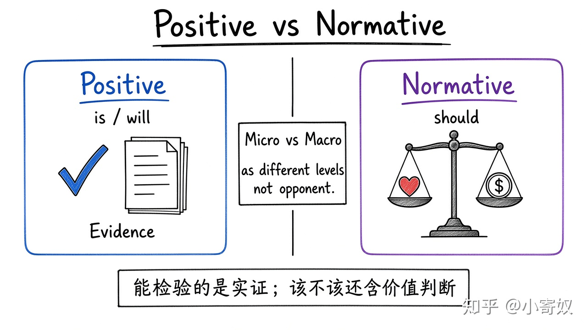

# 06｜微观、宏观、实证与规范

- 所属单元：Unit 01
- 建议用时：15 分钟
- 本节只解决：**怎样区分研究层级、可检验事实和价值判断？**
- 导航：[上一节](05_circular_flow_ppf.md) · [返回单元首页](README.md) · [下一节](07_correlation_causality.md)

## 0～2 分钟：主动回忆

> 怎样区分研究层级、可检验事实和价值判断？

## 本节术语

| 中文术语 | English | 缩写 | 通俗解释 |
|---|---|---|---|
| 微观经济学 | Microeconomics | Micro | 消费者、企业与具体市场的决策与互动。 |
| 宏观经济学 | Macroeconomics | Macro | 总产出、失业、通胀与增长等总体变量。 |
| 实证表述 | Positive Statement | 无通用缩写 | 描述是什么或会发生什么，原则上可用证据检验。 |
| 规范表述 | Normative Statement | 无通用缩写 | 讨论应该怎样，包含价值排序。 |

## 2～9 分钟：核心内容

Micro 与 Macro 是问题层级不同，不是对立阵营。实证表述（Positive Statement）谈「是什么 / 若 X 变则 Y 怎样」，可用证据检验；规范表述（Normative Statement）谈「应该怎样」，含效率、公平、自由等价值排序。

数据能估计政策后果，却不能单独决定社会该如何权衡价值。

## 9～12 分钟：最小例子

「提高碳税会减少高排放商品交易量」是实证；「即使短期加重部分家庭负担，政府也应该提高碳税」是规范。前者被证实，后者仍需价值判断。

## 12～14 分钟：你来做

各写一句关于自动驾驶补贴的实证与规范表述，并说明各需要什么证据或价值前提。

## 14～15 分钟：费曼复述

> Micro 研究 ______；Macro 研究 ______。实证可以 ______，规范还包含 ______。

## 适用边界

「应该」是提示而非唯一标准；有些规范判断用陈述语气包装，仍要检查是否含价值排序。

## 完成证据

- [ ] 能说出本节英文术语与缩写
- [ ] 完成最小例子
- [ ] 保留了自己的判断过程
- [ ] 一句话复述与疑问已写入[工作簿](../workbook.md)
