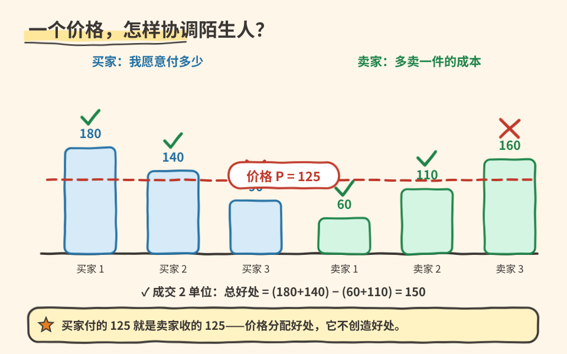

# 06｜陌生人互不亏欠，交换为什么双赢？

> ⏱ 核心 10–15 分钟 ｜ 一个问题 · 一张图 · 一道题 · 一分钟复述

**本课问题：自愿交换的收益从哪里来？价格在其中到底做了什么？**

先修回顾：激励改变相对得失。这一课看成千上万陌生人怎么不靠中央指挥协调起来——靠价格。看完你会对“涨价”这件事少一分情绪，多一分机制理解。

## 先看一张图

左边蓝柱：三位买者最多愿意付 180、140、90。右边绿柱：三份服务的新增成本 60、110、160。虚线是价格 125。**谁成交不看身份，只看各自的数和价格线的位置。**

## 用一组数字看懂协调

| 中文 | 原始英文 | 一句话意思 |
|---|---|---|
| 贸易 | Trade | 无通用缩写。个人、企业或经济体之间交换商品与服务，不专指跨国买卖。 |
| 市场 | Market | 无通用缩写。买方卖方互动达成交换的安排，线上、线下、合同里都算。 |
| 专业化 | Specialization | 无通用缩写。把资源集中于部分活动，再经交换取得其他成果。 |

价格为 125 时（自编案例，暂设无交易费用、无质量差异、不影响第三方）：

→ 买者 1：180＞125，买，净得 55；买者 2：140＞125，买，净得 15；买者 3：90＜125，退出。

→ 卖方前两份成本 60、110，都低于 125，愿卖，分别净得 65、15；第三份成本 160＞125，不生产。

成交两份，双方合计净收益：

$$
55+15+65+15=150\text{ 元},\qquad\text{等价地 }(180+140)-(60+110)=150。
$$

**注意第二个算式里没有 125。** 买方付的 125 正是卖方收的 125，合并后抵消。价格决定收益**怎么分**，却不是收益的来源——收益来自把服务交给评价更高的人、用更低成本提供。第三份价值 90、成本 160，强行成交会额外损失 70。

价格同时干两件事：给使用者一个节约稀缺资源的理由，给提供者一个增加产出的理由。**没人需要知道全局计划，每个人只对自己的相对得失响应**——这就是分散协调。

## 别急着把机制当真理

本例没证明现实市场永远最优：卖方隐瞒质量，买者判断会失真；生产污染附近居民，60 元成本没包含全部代价；少数企业控制价格，过程就变了。这些后续单元逐个展开。另外价格变了，数量也不会瞬间到位——合同、产能、信息都限制响应速度。价格提供信号，真实响应取决于系统约束，这点和你熟悉的反馈系统很像，但别把经济当成目标函数已知的控制器。

## 一道题自测

价格改成 150。愿买几人、愿卖几份？为什么“价格越高大家越赚钱”不成立？

展开答案

只有支付意愿 180 的买者还买，**愿买 1 份**；成本 60、110 的两份仍愿卖，**愿卖 2 份**。愿卖不等于卖得掉：提价增加了每份收入，却挤走了第二位买者。成交量和利润怎么变不能一口断定——供需单元会用“过剩”解释这种不匹配带来的调整压力。

## 接到你的工作（可选，约 2 分钟）

公司内部其实也有“价格”：算力配额、优先级、内部计费。它们同样在协调陌生人的选择。当一个资源长期“免费”，想想它失去了哪个信号功能。

## 一分钟讲给别人听

用三买者三卖家讲清：自愿交换的收益从哪来？为什么说价格只分蛋糕、不做蛋糕？

**本课一句话：自愿交换把东西交给评价更高、成本更低的人；价格是信号，不是收益的来源。**

教材主题索引：曼昆第 1 章贸易与市场；外部性、市场势力留待后续单元。数值为自编。

[上一课](05_incentives.md) · [返回单元首页](README.md) · [下一课：删掉细节的模型为什么还有用？](07_models_simplify.md)

把自测的原始答案和复述卡点记入[课程工作簿](../workbook.md)。
