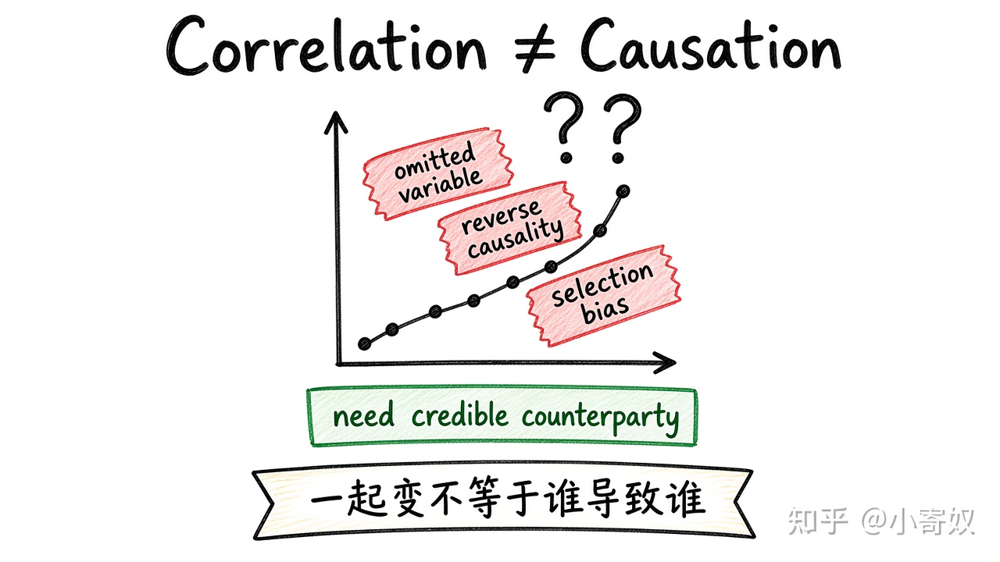

# 07｜相关性、因果关系与替代解释

- 所属单元：Unit 01
- 建议用时：15 分钟
- 本节只解决：**看到两个变量一起变化时，为什么不能立即下因果结论？**
- 导航：[上一节](06_micro_macro_positive_normative.md) · [返回单元首页](README.md) · [下一节](08_unit_review.md)

## 0～2 分钟：主动回忆

> 看到两个变量一起变化时，为什么不能立即下因果结论？

## 本节术语

| 中文术语 | English | 缩写 | 通俗解释 |
|---|---|---|---|
| 相关性 | Correlation | Corr. | 两个变量共同变化，但不自动证明因果。 |
| 因果关系 | Causality | 无通用缩写 | 一个变量的变化真正导致另一个变量变化。 |

## 2～9 分钟：核心内容

相关性（Correlation, Corr.）只说明一起变；因果关系（Causality）要求「谁导致谁」。从相关到因果，优先检查三类替代解释：遗漏变量、反向因果、选择偏差；再核对指标是否代表目标、是否只是共同时间趋势。

更可信证据的核心是：构造「如果没有这项变化，结果本来会怎样」的反事实（随机试验、自然实验、合理对照等）。不必同时背一长串方法清单——先会问替代解释。

## 9～12 分钟：最小例子

用 AI 编程工具的人提交更多：可能是工具提效，也可能是高能力者更爱用工具，或任务重的人更需要工具。提交数 ≠ 质量与生产率。

## 12～14 分钟：你来做

为「经常运动的人收入更高」提出：两个遗漏变量、一个反向因果、一种更可信验证方式。

## 14～15 分钟：费曼复述

> 相关性只说明 ______；要支持因果，须排除 ______、______ 和选择偏差，并建立可信 ______。

## 适用边界

很少能排除全部不确定性。因果结论应写清识别假设、样本范围与外推边界。

## 完成证据

- [ ] 能说出本节英文术语与缩写
- [ ] 完成最小例子
- [ ] 保留了自己的判断过程
- [ ] 一句话复述与疑问已写入[工作簿](../workbook.md)
