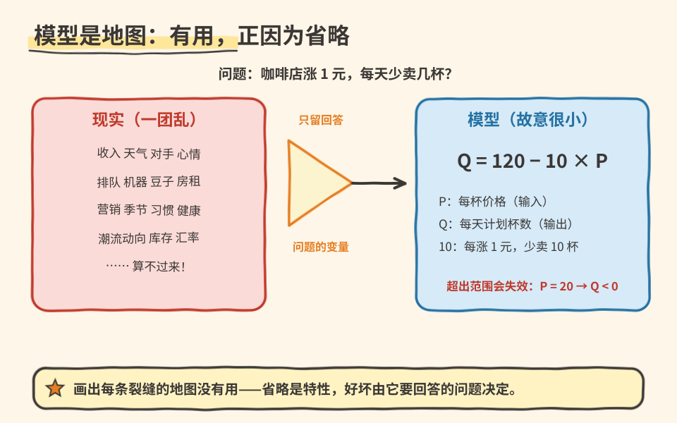

# 07｜删掉了细节的模型，为什么还有用？

> ⏱ 核心 10–15 分钟 ｜ 一个问题 · 一张图 · 一道题 · 一分钟复述

**本课问题：一个明知“不真实”的模型，凭什么能指导决策？**

先修回顾：价格协调听起来很美，但真实世界有收入、天气、竞品、心情……全算进去谁也算不动。经济学的解法和工程一样：**建一个故意很小的模型**。

## 先看一张图

道路地图不画每块路面的裂纹，因为找路时它们不重要；做悬架设计时，裂纹又变得重要。**省略是否合理，取决于你要回答的问题。**

## 把模型的零件拆开

| 中文 | 原始英文 | 一句话意思 |
|---|---|---|
| 经济模型 | Economic Model | 无通用缩写。为解释特定问题而保留关键因素的简化表达。 |
| 内生变量 | Endogenous Variable | 无通用缩写。由模型内部关系决定的变量。 |
| 外生变量 | Exogenous Variable | 无通用缩写。当前模型里由外部给定的变量；换个模型身份可能变。 |
| 参数 | Parameter | 无通用缩写。描述关系的系数，本课视为暂时固定。 |

自编教学关系——关心“咖啡店单独改价会怎样影响计划购买量”，先固定收入、天气、竞品价格、口味：

$$
Q=120-10P,\qquad 0\leq P\leq12。
$$

字母是数学记号，不是术语缩写。$P$ 是单杯价格（元/杯），$Q$ 是一天计划购买量（杯/天）。120 是零价格处的数量截距，10 表示价格每升 1 元、计划购买量减少 10 杯。**等式不是对任何真实店铺的估计**，只在给定范围内用它练推理。

## 变量身份会变，适用域会断

在这个局部模型里，价格由店家给定 → 外生输入；购买量是输出。到了供需共同决定价格的模型里，**价格就变成内生变量**。所以“价格总是外生的”不是结论，变量身份取决于模型边界画在哪。

适用域更要盯紧：把 $P=20$ 代入会得到负购买量——这不说明顾客“倒贴”，只说明线性关系不能外推到那个范围。你可以另写零下限规则，但那是对模型的**明确修改**，不能装作原模型一直正确。

## 一道题自测

机器一天最多做 30 杯。价格为 8 元时模型给出 $Q=40$。能说“明天实际销量 40 杯”吗？

展开答案

不能。模型说的是**计划购买量**，机器产能 30 杯是另一个约束。购买计划、生产能力、实际成交是三个不同对象。要研究实际销量，模型就得补产能与交易过程——这正是“先问问题，再决定模型留什么”。

## 接到你的工作（可选，约 2 分钟）

训练误差低不保证新场景有效——你早就懂这个道理。经济模型多一层麻烦：被研究的对象会**根据规则改变策略**，参数稳定性本身就是问题。好模型和坏模型的区别不在复杂度，在“是否回答了原问题、忽略项会不会翻盘、能不能被独立数据检验”。

## 一分钟讲给别人听

用咖啡模型说清：研究问题、输入、输出、参数单位、适用范围，各是什么。

**本课一句话：模型因省略而有用；省略对不对，由问题和适用域裁决。**

教材主题索引：曼昆第 2 章“经济学家如何思考”、模型与假设。关系式为自编。

[上一课](06_trade_price_coordination.md) · [返回单元首页](README.md) · [下一课：价格和销量一起涨，涨价就没影响吗？](08_ceteris_paribus.md)

把自测的原始答案和复述卡点记入[课程工作簿](../workbook.md)。
