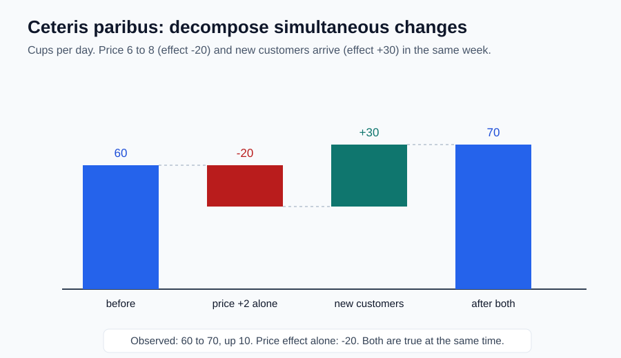

# 08｜价格和销量一起涨，涨价就没影响吗？

> ⏱ 核心 10–15 分钟 ｜ 一个问题 · 一张图 · 一道题 · 一分钟复述

**本课问题：现实里几个因素同时变化时，怎样把单个因素的作用拆出来？**

先修回顾：上一课的模型固定了收入、天气、客流。可现实不会配合你——它们真的会同时动。这一课学一个拆解动作，它是后面所有因果分析的起点。

## 先看一张图

总账：60 → 70，涨了 10。拆开看：**提价的单独作用是 −20，新客流的单独作用是 +30**。两件事同周发生，互相不矛盾。

## 术语只有一个

| 中文 | 原始英文 | 一句话意思 |
|---|---|---|
| 其他条件不变 | Other Things Equal；拉丁语 Ceteris Paribus | 无通用缩写，不要写成 CP。分析一个因素时，暂时固定其他相关因素。 |

沿用上一课的模型 $Q=120-10P$。价格为 6 时 $Q_0=60$；只提价到 8：

$$
Q_1=120-10\times8=40,\qquad \Delta Q=-20\text{ 杯/天}。
$$

$\Delta$ 是“变化量”记号。结论的完整说法是：**在收入、偏好等条件相同的前提下**，单独提价 2 元，计划购买量减少 20 杯。

现在开学，附近来了新顾客，每个价格下计划购买量都多 30：$Q'=150-10P$。开学后价格从 6 涨到 8，购买量变成 $150-80=70$，比原来的 60 还高。

**观察到“价涨量也涨”，能证明顾客喜欢高价吗？不能。** 客流也变了。分解：先只提价 60→40，再叠加新客 40→70，合计 $-20+30=+10$。顺序颠倒在本例（线性相加）结果相同；现实有交互作用时更复杂，但**比较基准必须说清楚**。

## “其他条件不变”不是鸵鸟政策

它不是宣称世界不动，而是**一次隔离一种机制**。两个提醒：

→ 观察数据不会自动帮你固定其他因素——所以“模型推导正确”和“现实因果证据充分”要分开检查。

→ 不能用“也许其他条件变了”让模型永远免于检验。真实数据在相同条件下长期偏离模型，就该修参数或结构。

## 一道题自测

价格从 6 降到 5，同时坏天气使每个价格下的购买量减 15 杯。新购买量是多少？销量下降能证明降价无效吗？

展开答案与反事实

只降价：$120-10\times5=70$ 杯；叠加天气：$70-15=55$ 杯，比原来 60 少 5。但同一天的正确比较基准是“坏天气且不降价”：$120-60-15=45$ 杯。**降价仍多带来 10 杯**——前后变化 −5 和价格单独作用 +10 不是同一个量。

## 接到你的工作（可选，约 2 分钟）

换了感知模型，路测通过率涨了——但测试路线也从城区换成了园区。这堂经济课的语言你直接能用：模型版本和路线难度同时变化，不能把全部变化记给版本。做“相同条件下只换模型”的比较，并报告场景分层结果。

## 一分钟讲给别人听

用瀑布图讲清：为什么 60→70 和“提价减少购买量”可以同时成立？

**本课一句话：同时变化 ≠ 各自的作用消失；先固定其他条件，再谈一个因素的影响。**

教材主题索引：曼昆第 2 章假设与“其他条件不变”。数值为自编。

[上一课](07_models_simplify.md) · [返回单元首页](README.md) · [下一课：一杯咖啡的钱流向哪里？](09_circular_flow.md)

把自测的原始答案和复述卡点记入[课程工作簿](../workbook.md)。
