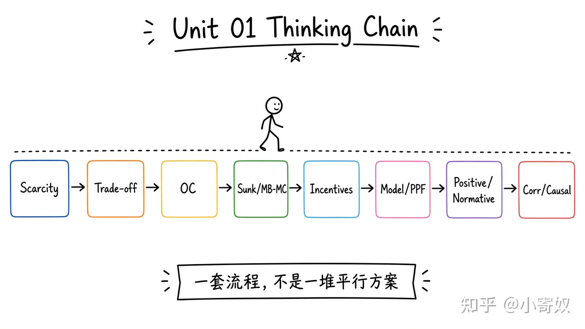

# 08｜单元复盘：用经济学思维分析一个真实问题

- 所属单元：Unit 01
- 建议用时：15 分钟
- 本节只解决：**能否把本单元概念连成一套可执行分析流程？**
- 导航：[上一节](07_correlation_causality.md) · [返回单元首页](README.md)

## 0～2 分钟：主动回忆

> 能否把本单元的概念连接成一套可执行分析流程？

## 本节术语（复用）

| 中文术语 | English | 缩写 |
|---|---|---|
| 机会成本 | Opportunity Cost | OC |
| 边际收益 | Marginal Benefit | MB |
| 生产可能性边界 | Production Possibilities Frontier | PPF |
| 因果关系 | Causality | 无通用缩写 |

## 2～9 分钟：核心内容

闭卷回忆这一条主线（**一套流程，不要另起平行方案**）：



```text
稀缺性 → 权衡 → 机会成本
→ 沉没成本与边际分析
→ 激励与市场协调
→ 模型与 PPF
→ 实证 / 规范
→ 相关 / 因果
```

选一个真实问题（如「是否继续一个效果一般的算法项目」），依次只写：主体、目标、约束、方案、OC、未来 MB/MC、激励、可观察指标、替代解释、适用边界。

## 9～12 分钟：最小例子

AI 工具采购：不能只看「提交更多」。比较许可证成本、学习时间、质量变化与最佳替代；区分相关与因果；写明结论适用于哪些任务与员工。

## 12～14 分钟：你来做

10 分钟内：①画一张 PPF；②一句实证 + 一句规范；③为一个相关提出两个替代解释；④用 1 分钟向非专业听众讲清本单元。

## 14～15 分钟：费曼复述

> 经济学思维不是背术语，而是从 ______、______、机制、证据和 ______ 出发分析选择。

## 适用边界

完成本节只是第一轮地图。D1、D3、D7 仍要用新题验证保持与迁移。

## 完成证据

- [ ] 能说出本节英文术语与缩写
- [ ] 完成最小例子
- [ ] 保留了自己的判断过程
- [ ] 一句话复述与疑问已写入[工作簿](../workbook.md)
