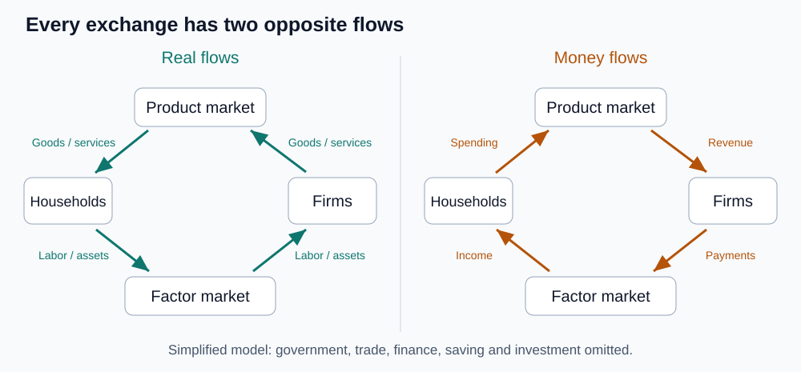

# 09｜一杯咖啡的钱，最后流向哪里？

> ⏱ 核心 10–15 分钟 ｜ 一个问题 · 一张图 · 一道题 · 一分钟复述

**本课问题：怎样用一张图看清家庭和企业在经济里交换的两种“流”？**

先修回顾：模型靠省略回答问题。这一课的图把经济简化到只剩两类人——家庭和企业——但足够让你看清一笔钱怎么循环。

## 先看一张图

图中文字对照：Households＝家庭，Firms＝企业，Product market＝产品市场，Factor market＝要素市场。Goods / services 是商品与服务，Labor / assets 是劳动和资产投入；Spending / Revenue 对应消费支出与销售收入，Payments / Income 对应要素支付与要素收入。

**读图方法：先挑一笔交易，再找它的反向流。** 企业付工资 → 获得劳动服务；家庭付咖啡钱 → 获得咖啡。每一笔都有来有往。

## 两个市场，四种流

| 中文 | 原始英文 | 一句话意思 |
|---|---|---|
| 循环流向图 | Circular-flow Diagram | 无通用缩写，不要写成 CFD（易与计算流体力学混淆）。表现主体间实物与货币的流动。 |
| 生产要素 | Factors of Production | 无通用缩写。生产商品和服务的投入：劳动、土地、设备。 |

→ **产品市场**：家庭花钱买咖啡，商品从企业流向家庭，货币反向流。

→ **要素市场**：家庭提供劳动和自有设备的使用服务，投入流向企业，工资等收入反向流。

同一个人可以既是顾客、又是劳动者、还是股东——**身份由交易决定，不是永久标签**。

## 这张图没说什么

它帮你分清收入和支出的位置，**但没说收入分配是否公平**。它主动省略了政府、对外贸易、银行和储蓄投资。两个不能做的推断：

→ “画了循环，所以家庭工资必须立刻全部花掉。” 不能，储蓄被省略了，不是被禁止了。

→ “企业拿到的钱都是卖商品的收入。” 不能，银行贷款是另一类流动，不在此图。

图是特定问题的答案，不是经济的全貌。

## 一道题自测

你周末给邻居公司做了 4 小时顾问，对方转账 2000 元。这笔交易发生在哪个市场？实物流和货币流各是什么方向？

展开答案

要素市场。实物流：你的劳动服务从你（家庭）流向公司（企业）；货币流：2000 元要素收入从企业流向你。注意你此刻的身份不是“消费者”，是劳动的供给方——同一个人在不同交易里身份不同。

## 接到你的工作（可选，约 2 分钟）

把你所在的公司画进这张图：工资是要素收入流向你，你的劳动流向企业；公司产品流向客户，营收流回企业。再想想：内部转账（部门间结算）属于图里的哪种流？

## 一分钟讲给别人听

指着图说出一个实物流和它的反向货币流；再说一件此图故意不画的东西。

**本课一句话：每笔交易都是双向的——货过去，钱回来。**

教材主题索引：曼昆第 2 章循环流向图。图为自编教学示意。

[上一课](08_ceteris_paribus.md) · [返回单元首页](README.md) · [下一课：同一批资源最多能做出多少组合？](10_ppf.md)

把自测的原始答案和复述卡点记入[课程工作簿](../workbook.md)。
