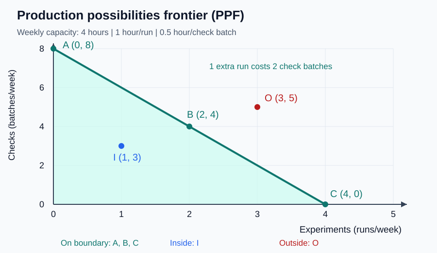

# 10｜同一批资源，最多能做出多少组合？

> ⏱ 核心 10–15 分钟 ｜ 一个问题 · 一张图 · 一道题 · 一分钟复述

**本课问题：给定资源和技术，两种产出的“天花板组合”长什么样？**

先修回顾：稀缺要求取舍（第 1 课），机会成本给取舍标价（第 2 课）。这一课把两件事画成一条线——**生产可能性边界**。

## 先看一张图

读图顺序：**先读轴**——横轴是每周实验次数，纵轴是每周质检批数；再看线上的点、线内的点、线外的点。别把纵轴想象成地图的“前方”，经济图的轴只代表数量。

## 一个例子算出整条边界

| 中文 | 原始英文 | 一句话意思 |
|---|---|---|
| 生产可能性边界 | Production Possibilities Frontier | PPF。给定资源与技术时，两种产出能达到的最大组合边界。 |
| 生产效率 | Productive Efficiency | 无通用缩写。要增加一种产出，必须减少另一种产出。 |

自编情形：小团队本周有 4 小时设备时间。一次模型实验占 1 小时，一批数据质检占 0.5 小时，互斥使用设备。设 $x$ 为实验次数、$y$ 为质检批数：

$$
x+0.5y\leq4 \;\Rightarrow\; y=8-2x\;(\text{用足资源时})。
$$

| 组合 | 实验 x | 质检 y | 占用时间 | 含义 |
|---|---:|---:|---:|---|
| A | 0 | 8 | 4 小时 | 边界上 |
| B | 2 | 4 | 4 小时 | 边界上 |
| I | 1 | 3 | 2.5 小时 | 边界内，1.5 小时闲置 |
| O | 3 | 5 | 5.5 小时 | 边界外，现有资源达不到 |

从 A 到 B：实验 +2，质检 −4，**每多一次实验的机会成本 = $4/2=2$ 批质检**。单位是“批/次”，不是元。直线斜率 −2 的负号表示此消彼长，绝对值 2 才是机会成本。

## 三种移动，三种完全不同的故事

→ **沿边界走**（A→B）：资源已用满，重新分配必须付出代价。

→ **从内向边界走**（I→B）：实验和质检同时增加——因为原来有资源闲着。这不能否认机会成本，只是约束还没用满。

→ **边界外移**：设备时间从 4 小时涨到 5 小时，边界变 $y=10-2x$，生产能力真正扩大。若只是质检提速一倍，边界绕实验截距**转动**（质检截距 8→16），不是两边等比例平移。

最后两点提醒。本例是直线，因为两种工作耗时固定、切换效率相同；现实中先调最适合的资源、再调不适合的，机会成本递增，边界通常**向外弯**。另外，边界上 ≠ 最值得选——A 和 B 都有生产效率，选哪个取决于实验和质检的价值排序，那是偏好问题，不是这张图能回答的。

## 一道题自测

设备时间变成 5 小时，技术不变。组合“3 次实验、4 批质检”在边界哪里？从该组合再多做一次实验，至少少做几批质检？

展开答案

$3\times1+4\times0.5=5$ 小时，正好在**新边界上**。多一次实验要 1 小时，必须少做 $1\div0.5=2$ 批质检，新组合为 (4, 2)。别因为“新边界更靠外”就以为扩产不需要取舍——只要约束被用满，取舍就在。

## 接到你的工作（可选，约 2 分钟）

有人工作 8 小时却只工作 6 小时、休息 2 小时，能说他“低效率”吗？**不能直接说。** 图里若只画两种工作产出，休息被排除在目标之外；但休息本身有价值，还可能提升之后的效率。PPF 是指定产出和资源下的模型，不能拿它把所有非市场活动判成浪费。

## 一分钟讲给别人听

指着图讲：边界内、边界上、边界外各是什么意思？从 A 到 B 的机会成本是多少、单位是什么？

**本课一句话：边界画的是“能做到什么”，不是“应该做什么”。**

教材主题索引：曼昆第 2 章生产可能性边界。数值为自编。

[上一课](09_circular_flow.md) · [返回单元首页](README.md) · [下一课：一句话该用哪套工具分析？](11_micro_macro_positive_normative.md)

把自测的原始答案和复述卡点记入[课程工作簿](../workbook.md)。
