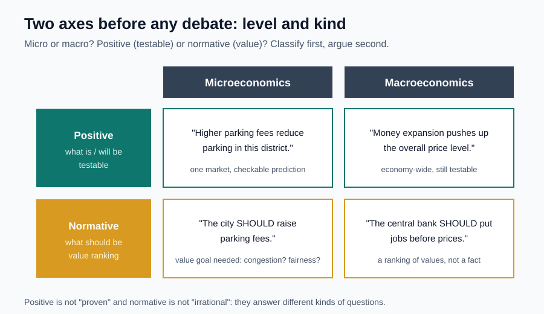

# 11｜一句话，该用哪套工具分析？

> ⏱ 核心 10–15 分钟 ｜ 一个问题 · 一张图 · 一道题 · 一分钟复述

**本课问题：听到一项经济主张，怎样先分类、再决定跟谁争论什么？**

先修回顾：PPF 说“能做到什么”，偏好说“希望做什么”。这对区分有张更大的版本——**事实归事实，价值归价值**。这一课给你两把尺子，以后遇到任何主张先量一下。

## 先看一张图

两把尺子互相独立：**研究层级**（微观/宏观）管“用哪套工具”，**陈述性质**（实证/规范）管“证据能回答什么”。任何一句话都可以先放进这四个格子之一。

## 第一把尺：微观还是宏观

| 中文 | 原始英文 | 一句话意思 |
|---|---|---|
| 微观经济学 | Microeconomics | Micro 是常见简称，不是缩写。研究个人、企业及具体市场的选择与互动。 |
| 宏观经济学 | Macroeconomics | Macro 是常见简称。研究总体产出、通货膨胀、失业等总体问题。 |

**不是小事和大事之分。**“一家咖啡店提价后能卖多少”是微观；“全国新能源汽车市场如何竞争”规模很大，但研究的是具体市场，仍属微观；“全国总体物价为什么持续上升”才是宏观。政府出台政策也不自动变成宏观问题——一个城市的停车收费对司机选择的影响，用微观框架就够。

你关心的企业投资分析，大部分经营机制在微观范畴；黄金这种同时受利率、货币、风险偏好影响的资产，别指望一张局部图就能预测。分层的意义是**找到所需工具**，不是贴永久标签。

## 第二把尺：实证还是规范

| 中文 | 原始英文 | 一句话意思 |
|---|---|---|
| 实证表述 | Positive Statement | 无通用缩写。描述是什么、会怎样，原则上能用证据检验。 |
| 规范表述 | Normative Statement | 无通用缩写。表达应该怎样，涉及公平、自由、安全等价值排序。 |

Positive 不是“积极的”，Normative 也不是“写得规范”。两个要点：

→ **实证 ≠ 已证实。**“提高停车费会减少部分人在此停车”可检验；“提高停车费完全不影响任何人”同样是实证表述——哪怕它将被证据推翻。是不是实证，看能否检验，不看对不对。

→ **规范 ≠ 不理性。**“中心城区应该提高停车费”背后有目标：为拥堵？为收入？公平与安全可以被明确讨论，规范论证也要逻辑一致。

现实表达常把两类焊在一起：“涨价会减少拥堵，**所以应该**涨价。”前半句要因果证据，后半句藏着价值前提（比如减少拥堵的收益超过受影响者的损失）。**拆开以后，争论才能定位：分歧在事实估计，还是在价值权重。**

自编预算例：2 万元二选一。A 服务 100 人、每人 300 元等值收益；B 服务 50 人、每人 700 元。按“净收益总额最大”，B 多 5000 元，选 B——这是给定目标后可复算的判断。但重视覆盖人数的人会选 A；后来发现 B 每人收益只有 500，推荐就翻回 A。**事实修正改变推荐，价值目标没变**——两类变化分开，才明白争论为何发生。

## 一道题自测

①“公交降价后，工作日乘车人次会增加。”②“为了让低收入居民受益，公交票价应该更低。”各属哪类？是微观问题吗？

展开答案

①实证预测，可在明确范围和可比条件下检验——不因尚未验证而变成规范。②规范主张，含“优先减轻低收入居民负担”的价值选择，同时隐含“降价确实使其受益”的实证前提。两句都是具体公交市场的**微观**问题；政府参与不自动把它们变宏观。

## 接到你的工作（可选，约 2 分钟）

“新算法在测试集上少漏检 10%，所以今天就该全量上线。”拆一下：误报升没升、测试集覆盖够不够（实证）；漏检和误制动怎么权衡、最低安全标准是什么（规范/决策标准）。**指标改善到“应该上线”之间，缺的不是热情，是明确的发布标准。**

## 一分钟讲给别人听

找一句新闻评论，拆成可检验的事实、机制预测和“应该”背后的价值前提。说出两个人结论不同，可能是数据判断不同，也可能是目标排序不同。

**本课一句话：先分清“是什么”和“应该怎样”，再决定争什么。**

教材主题索引：曼昆第 2 章微观与宏观、实证与规范。案例为自编。

[上一课](10_ppf.md) · [返回单元首页](README.md) · [下一课：一起变化，就能说谁导致谁吗？](12_correlation_causality.md)

把自测的原始答案和复述卡点记入[课程工作簿](../workbook.md)。
