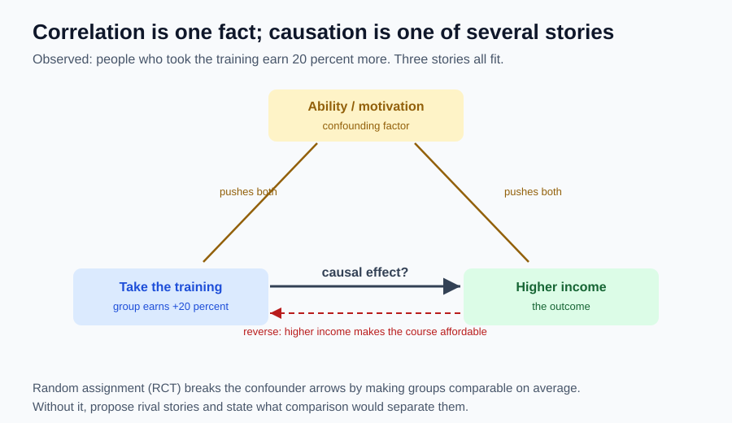

# 12｜一起变化，就能说谁导致谁吗？

> ⏱ 核心 10–15 分钟 ｜ 一个问题 · 一张图 · 一道题 · 一分钟复述

**本课问题：看到“用了某方法的人更成功”，怎样检查这方法是否真有用？**

先修回顾：实证主张原则上可检验（第 11 课），“其他条件不变”能隔离机制（第 8 课）。但真实数据不会自动替你固定条件——**因果判断需要额外的研究设计**。这是本单元最值钱的一课。

## 先看一张图

观察到一个事实：参加培训的人收入高 20%。**三条完全不同的故事都能产生这个事实**——因果、混杂、反向。数据本身分不出谁对谁错。

## 六个词，一张表

| 中文 | 原始英文 | 一句话意思 |
|---|---|---|
| 相关性 | Correlation | 统计中常用记号 $r$。两个量共同变化。 |
| 因果关系 | Causality | 无通用缩写。某种变化使结果不同于“没有它时”的结果。 |
| 反事实 | Counterfactual | 无通用缩写。同一对象，设想没接受干预时会怎样。 |
| 混杂因素 | Confounding Factor | 无通用缩写。同时影响原因与结果，把两者关系混在一起。 |
| 选择偏差 | Selection Bias | 无通用缩写。样本进入或分组方式使比较对象系统性不同。 |
| 随机对照试验 | Randomized Controlled Trial | RCT。随机分配形成处理组与对照组，提高可比性。 |

因果不要求“有原因就百分百发生”。培训可能提高通过概率、对不同的人效果不同。关键是**与可信的反事实比较**。

## 因果问题真正在问什么

你上了培训，考试从 60 涨到 80，差值 20 分人人会算。但培训效果问的是：**同样这段时间，你没上会考多少？** 如果自己复习也能到 75，培训的额外效果只有 5。

难就难在同一个人不能既上课又不上课。现实只能观察一种结果，另一种是反事实——所以找**可比的人或情境**来近似，而不是把过去的自己当完美对照（时间流逝、熟悉题型都在偷偷改变结果）。

## “参加者收入更高”的三个替代解释

→ **共同原因**：能力或动机强的人，既更愿报名，也更可能高收入。培训无效，两者仍相关。

→ **反向因果（Reverse Causality）**：不是上课让人有钱，是有钱人更买得起课。

→ **选择偏差**：宣传只展示完成课程且愿受访的人；退课者、未成功者不在样本里。

提出它们不是证明培训无效，而是说明**当前证据排除不了其他路径**。雨天雨伞销量和交通拥堵一起涨，也不会有人说卖伞导致拥堵——天气同时推着两者。

## 一个有对照的完整数例

自编试验：招募 200 位符合条件且同意参与的人，随机分两组各 100 人；一组上新培训，一组按原方式准备，参加相同考试。

| 组别 | 人数 | 通过 | 通过率 |
|---|---:|---:|---:|
| 新培训组 | 100 | 68 | 68% |
| 对照组 | 100 | 52 | 52% |

通过率差 $68\%-52\%=16$ 个百分点。注意口径：**“提高 16 个百分点”和“相对提高约 30.8%”不是一回事**（后者是 $(68-52)/52$），写结论时说明用哪个，别混。

随机分配让能力、动机在两组**平均而言**可比，差值更有理由解释为培训效果。但 100 人一组仍有随机波动——16 个百分点是估计，不是无误差的真值。另外，如果只挑“真正完成课程的人”跟全体对照者比，选择偏差又回来了：**随机分配保护不了你事后任意筛选的比较。**

## 没有随机试验时，保持清醒

企业不总能随机安排培训。自编小例：试点团队效率 50→65，未试点团队 40→50。前者前后 +15，但对照组也 +10；若有充分理由相信两组原本增幅相同，额外改善估计为 $(65-50)-(50-40)=5$。若两组面对的项目难度本来就不同，这个前提就失败——**不能仅凭做了减法就宣布识别了因果**。这和算法实验一个道理：新模型只测晴天、旧模型只测雨天，小数点再精确也救不了比较条件失衡。

## 一道题自测

某店投广告后销售额从 10 万变 13 万；恰逢节日，同地区相似店铺普遍在涨。3 万增量能全归给广告吗？需要补什么？

展开答案

不能。节日既可能推高销售额、又可能促使商家投广告，是现成的替代解释。可以找受相同节日冲击但没投广告的可比门店、看历史趋势、或在区域间随机分配广告。若可比对照同期涨了 2 万且共同趋势前提可信，广告额外效果接近 1 万；没有这些条件，只能说“观察到前后增长 3 万”。

## 接到你的工作（可选，约 2 分钟）

你每天都在做因果判断：指标涨了是模型改的，还是数据分布变了、评测集换了？把“前后差”翻译成“相对可信反事实的额外效果”，是你从这门课带走的最直接的工程习惯。

## 一分钟讲给别人听

用考试分数讲“前后差”与“相对没上课的额外效果”的区别；再各举一例共同原因、反向因果、选择偏差。最后回答：随机试验提高了什么可信度，又没消除什么不确定性？

**本课一句话：因果 = 与“没发生会怎样”比较；给不出可信反事实，就只谈相关。**

教材主题索引：曼昆第 2 章数据解释与因果；试验案例为本课程自编扩展。

[上一课](11_micro_macro_positive_normative.md) · [返回单元首页](README.md) · [下一课：单元复习——写一份可检查的决策说明](13_unit_review.md)

把自测的原始答案和复述卡点记入[课程工作簿](../workbook.md)。
