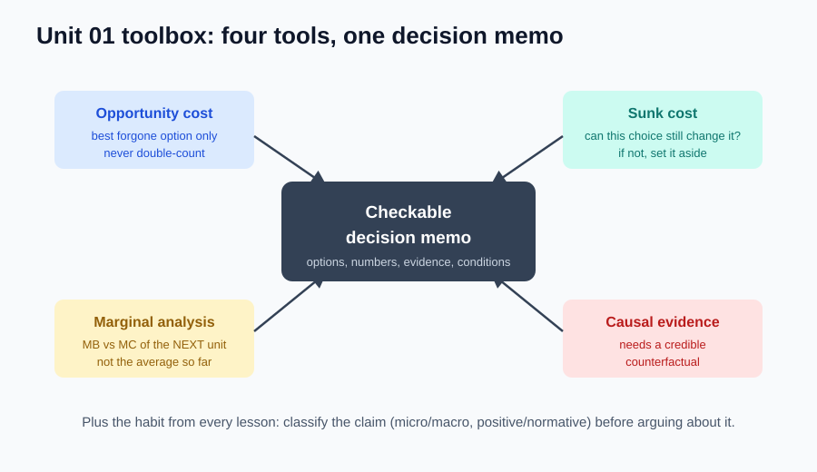

# 13｜单元复习：写一份能被别人检查的决策说明

> ⏱ 综合案例约 15–20 分钟（复习课可以稍长）｜ 不增加新概念，只调用旧工具

**本课任务：当投入、证据和个人目标混在一起时，给出一份讲得清、算得对的建议。**

先修要求：能解释机会成本与沉没成本，能读边际变化和因果证据。哪个词还只能背定义，回到对应课补一个例子再来。

## 本次只调用四个核心工具

| 中文 | English | 怎么用 |
|---|---|---|
| 机会成本 | Opportunity Cost | OC 为常见教学简写；找最佳被放弃用途，防重复计入。 |
| 沉没成本 | Sunk Cost | 无通用缩写；问“现在的选择能否改变它”。 |
| 边际收益与边际成本 | Marginal Benefit / Marginal Cost | MB / MC；决策单位要与可行行动匹配。 |
| 因果关系 | Causality | 无通用缩写；结论要有可信反事实支持。 |

## 综合案例：周末要不要把课程学完？

以下全部是自编教学数据。小林已为课程支付 3000 元，花过 20 小时。此刻退出能退 1000 元；只要继续学习任何部分，就失去退款资格。周末有 8 小时，可分成两个 4 小时块。

继续第一块的新增学习价值估为 1300 元等值，第二块再增加 900 元等值；均为**从现在起**的价值，不含过去已获得的能力。替代工作每个 4 小时块净收入 400 元，可做一块或两块。课程与替代工作互斥，无其他费用。假定休息等用途已比较过，替代工作是最佳备选，但个人估值仍可能有误差。

课程宣传还有一句：“完成课程的人，之后收入平均比没参加的人高 20%。”未交代原有收入、动机差异、退出者与比较时间。

**先合上答案**，完成五项任务：

1. 哪些是沉没成本？哪些支出或收益仍受当前决定影响？
2. 分别算出退出、只学一块、学完两块，从现在起的总价值。
3. 给出当前最佳方案，说明为什么不能只看第一块的净增益就停下。
4. 评价宣传信息的证据强度，写出至少两个替代解释。
5. 写一句有条件的建议：明确一个会改变建议的事实，和一个需要本人确认的价值判断。

完成后展开完整答案

历史 20 小时不可回收；已付费用中不可退的 2000 元也不受当前选择影响——两者沉没。可退的 1000 元仍相关，周末 8 小时及替代收益也相关。已学会的知识不因退课消失，不能只计入继续方案。

| 当前方案 | 新增学习价值 | 退款 | 剩余时间工作收入 | 未来总价值 |
|---|---:|---:|---:|---:|
| 退出 | 0 | 1000 | 800 | 1800 |
| 只学一块 | 1300 | 0 | 400 | 1700 |
| 学完两块 | 2200 | 0 | 0 | 2200 |

学完两块比退出多 $2200-1800=400$ 元等值。等价算法：新增学习价值减去放弃的退款和全部替代收入 $2200-1000-800=400$。两种方法等价，不能在表里扣过机会成本、最后又重复减一次。

只学第一块相对退出少 100；但第二块再增 $900-400=500$，合计仍多 400。失去退款是“一旦继续就发生”的一次性成本，不是每块都发生——所以比较可行方案的总结果。看到第一块净增益为负就机械停手，会漏掉更好的两块方案。

宣传数据只有组间相关，不能证明课程导致工资差：能力和动机可能同时影响完成课程与工资；高收入者也可能更负担得起课程；只展示完成者还漏掉退出者。需要原有条件、时间顺序和可信对照设计。

建议可写：“若新增学习价值合计确实高于 1800 元等值，且替代工作仍是最佳其他用途，学完两块更值得；需核验收益估计，也需确认本人对休息和职业发展的权重。”临界值是 1800，不是历史支出 3000。

## 怎么判定已经掌握

五项任务各 4 分，共 20 分：成本分类、三方案计算、行动规模解释、因果证据、条件化建议。每项“结论正确”2 分，“理由与边界完整”再 2 分。**建议达到 16 分，且前两项各至少 3 分**，再进入下一单元。这不是计时考试，可查漏补缺后换数再做。

先修正这些错误再继续：把 3000 元全当沉没；漏掉可退 1000；把过去的学习价值只算给继续；把“高 20%”直接当课程效果；既按净价值比较又重复扣现金费。记录错误时写“我漏掉了哪个可改变项”，比写“粗心”有用。

## 即时检查：只改一个数

若第二块学习价值由 900 降为 400，其余不变，哪个方案最好？先口算，再说改变的是事实估计还是价值目标。

展开答案

学完两块变为 $1300+400=1700$，只学一块仍 1700，退出 1800——**退出最好**。改变的是对新增学习价值的估计；比较标准没变。结论反转不需要重定义沉没成本，也不说明原先的算式错了。

## 迁移题：写自己的六句话决策记录

选最近一件真实小事（是否买课、是否追加一次实验），依次写：我要实现什么；稀缺资源是什么；真实备选有哪些；哪些历史投入不变；未来差异怎么比较；什么证据会让我改变选择。没有可靠数字时用范围或条件，不为完整而编造事实。

查看自检标准

合格记录让不了解背景的人也能复查：至少两种可行方案、一个最佳替代用途、一个被排除的沉没项、一个决定结果的未来差异、一条能使结论改变的证据。价值难以货币化时，明确优先级和取舍比给健康随意标价更可靠。本题没有统一行动答案，检查的是推理过程。

## 可直接讲的约五分钟费曼分享稿

> **题目：已经投入很多，为什么还是要重新做选择？**
>
> 我以前判断一件事值不值得继续，很容易先看已经投入了多少。课程花了几千元，项目做了几十小时，如果现在退出，就觉得前面的努力全白费了。学完这部分经济学，我发现应该先换一个问题：从现在开始，不同选择到底会让我得到什么、放弃什么？
>
> 经济学说资源稀缺，不只是钱少。今晚两小时只能用一次，学习、运动和兼职不能都完整占用它。选择学习，真正放弃的是未选方案里最好的那一个，这叫机会成本。如果兼职值三百，休息值两百，就不能把两者相加成五百，因为原本也不能同时获得它们。但如果休息对我更重要，就应该把休息放在比较的第一位，而不是只认现金收入。
>
> 再看已经买的课程。假设付了三千元，现在退课还能退一千元。不可退的两千元不受当前选择影响，是沉没成本；能退的一千元仍然会被决定改变，所以继续学就等于放弃这笔退款。“花过的钱不该管”这句话太粗糙，关键是现在能不能收回。
>
> 我还需要比较以后投入多少。假设周末分两块，第一块学习价值一千三，第二块再增加九百；每块也能兼职赚四百。退出拿到退款一千，再赚八百，一共一千八；学完两块得到两千二，所以在这些估值下，继续多四百。过去的三千元和二十小时，不需要再扣一次。只学一块反而只有一千七，因此最好的方案可能是学完，也可能是退出，不能凭“先做一点总没错”判断。
>
> 但算对还不够，数字从哪里来也很重要。广告说完成课程的人收入更高，可能是课程有用，也可能是这些人原本更有能力、更有动力，或者高收入的人更容易负担课程。看到两件事一起变化，只说明相关；要判断因果，还需要知道没有参加时会怎样，最好有可比的对照。
>
> 最后，经济学不是替我规定人生只追求收入。它帮助我看清约束、替代选择和证据，再按自己的目标做决定。如果我更需要休息，就把休息认真放进方案；如果新的证据降低了对课程收益的判断，就更新结论。好的决定不是永远坚持，也不是轻易放弃，而是能够说明：我为什么这样选，什么变化会让我重新选择。

## 一分钟压缩与下一步

把分享稿压成三句：过去哪些投入不变；未来怎样比较；当前证据为什么有条件。能用自己的例子讲清，比照稿读完更能证明掌握。

下一单元把“最佳替代用途”用于两个人的分工，再用供给与需求解释市场价格。

教材主题索引：曼昆第 1–2 章；本案例和分享稿为原创教学材料。

[上一课](12_correlation_causality.md) · [返回单元首页](README.md) · [进入单元 02](../unit_02_trade_and_market/README.md)

把原始答案、修正和复述卡点记入[课程工作簿](../workbook.md)。
