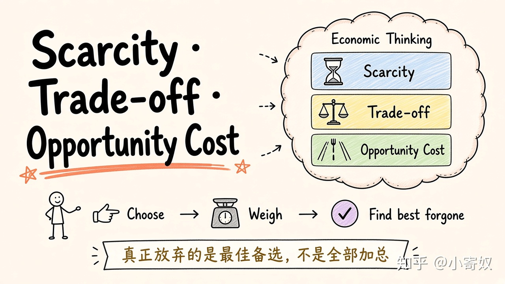
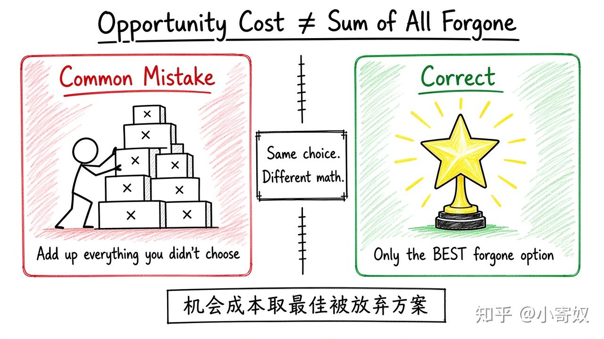
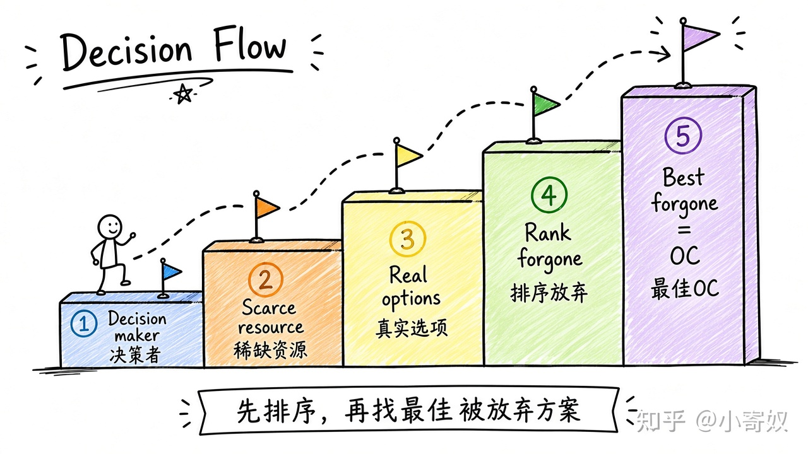
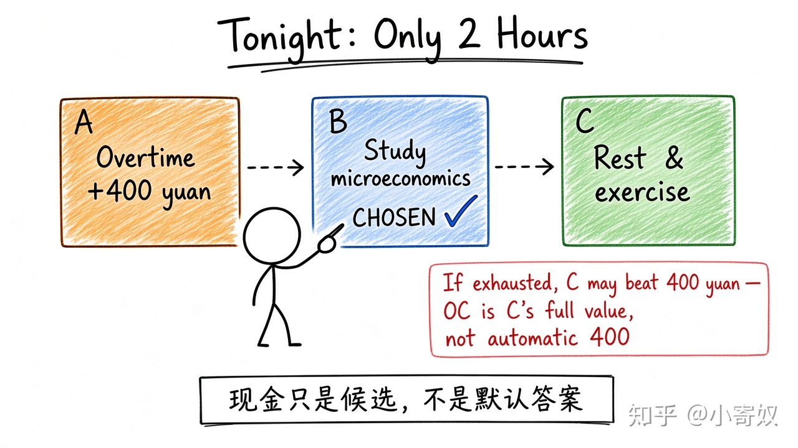

# 知乎发文稿｜01 稀缺性、权衡与机会成本

**BOT DRAFT · 未发布 · 需人工审阅**

- 源章节：`../../01_scarcity_opportunity_cost.md`（**原文未改**）
- 配图：手绘白板 sketchnote，风格对齐 [高阅读参考文](https://zhuanlan.zhihu.com/p/2070979462934565425)
- 排版节奏：封面图 → 各 h3 标题正下方跟一张图 → 两三句解释（图与图之间隔一整节，不连排）

---

## 标题备选（3）

1. 资源有限时，你真正放弃的是什么？稀缺性、权衡与机会成本
2. 机会成本不是「所有没选的加起来」：微观入门第一课
3. 今晚只有 2 小时：用一个例子把机会成本算清楚

**建议主标题：** 1

---

## 正文（可粘贴知乎）

资源有限时，怎样识别一个选择真正放弃了什么？

先别急着查定义。用一句话写下你此刻的判断——哪怕是「不知道」——读完再回看，会更有感觉。



### 三个术语，先立住

| 中文术语 | English | 缩写 | 通俗解释 |
|---|---|---|---|
| 稀缺性 | Scarcity | 无通用缩写 | 资源不足以同时满足所有有价值用途，因此必须选择。 |
| 权衡 | Trade-off | 无通用缩写 | 为了得到更多某一目标，需要减少或放弃另一目标。 |
| 机会成本 | Opportunity Cost | OC | 作出选择时，最佳被放弃方案的价值。OC 是教学中常用写法，但并非所有教材都固定使用。 |

术语规则：第一次出现时记住「中文（English, 缩写）」；没有公认缩写就写「无通用缩写」，不要自己编。

### 为什么机会成本常被算错

微观经济学从稀缺性（Scarcity，无通用缩写）开始。稀缺不是「什么都没有」，而是目标多于可同时使用的资源。你可能同时想加班、学习、运动和休息，但同一段时间不能重复使用，所以必须权衡（Trade-off，无通用缩写）。



权衡只说明「得到更多 A，通常要少一些 B」。机会成本（Opportunity Cost, OC）进一步要求找出：如果不选当前方案，未选方案中价值最高的是哪一个。机会成本不是所有放弃项之和，也不一定是现金。健康、精力、未来效率和失去的职业机会都可能进入价值比较。

### 用固定五步把决策拆开

分析顺序可以固定为：决策主体是谁 → 稀缺资源是什么 → 有哪些真实可选方案 → 未选方案怎样排序 → 最佳被放弃方案是什么。



先排序，再锁定「最佳被放弃方案」——这一步才是 OC，而不是把没选的全部加总。

### 最小例子：今晚只有 2 小时

今晚只有 2 小时：A 加班得 400 元，B 学习微观经济学，C 休息运动。若你选择 B，不能只凭「400 元」认定 OC=400 元。若极度疲劳，C 对健康和明日效率的价值可能更高；此时机会成本是 C 的完整价值。



现金只是候选，不是默认答案。

### 你来做

写出你过去 7 天的一个三选一决定，并填写：

```text
稀缺资源：
三个方案：
最终选择：
最佳被放弃方案：
机会成本中的现金价值：
机会成本中的非现金价值：
```

### 费曼复述

合上材料，用自己的话完成：

> 稀缺性迫使我进行 ______；选择某方案的机会成本是 ______，而不是 ______。

### 适用边界

机会成本依赖个人目标、信息和约束。它帮助比较方案，但不会自动给出所有人相同的选择。

---

### 发文注意

- 学习笔记草稿，**非投资建议**。
- 上传知乎时把 `./assets/*.jpg` 换成实际上传图；保持「标题 → 图 → 短文」节奏，图与图之间不要连排。
- 图右下角已有水印「知乎 @小寄奴」，发文账号不一致时请自行裁掉或重出。

**BOT DRAFT · 未发布 · 需人工审阅**
