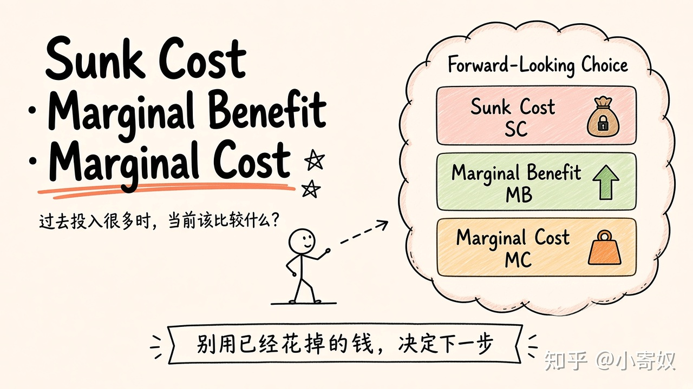
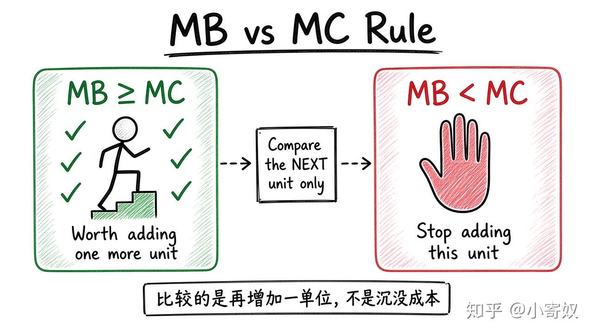
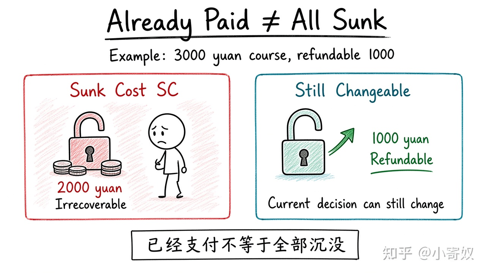
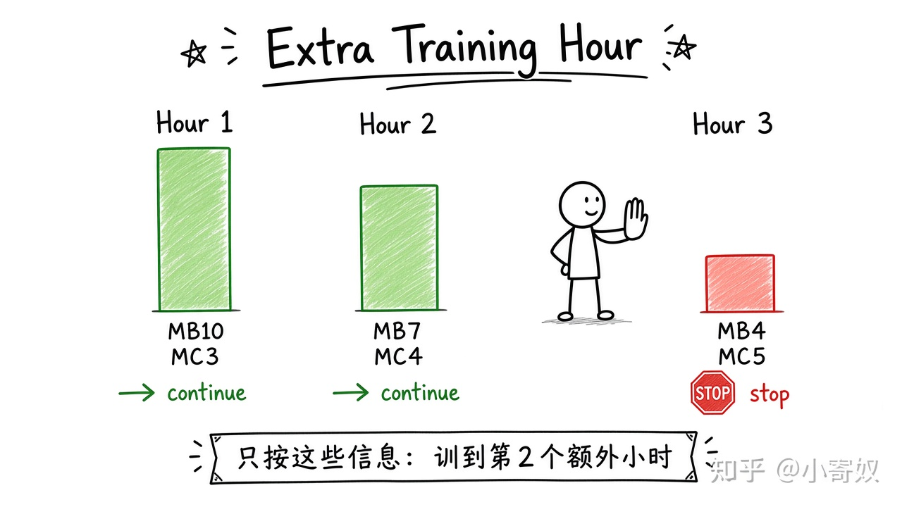
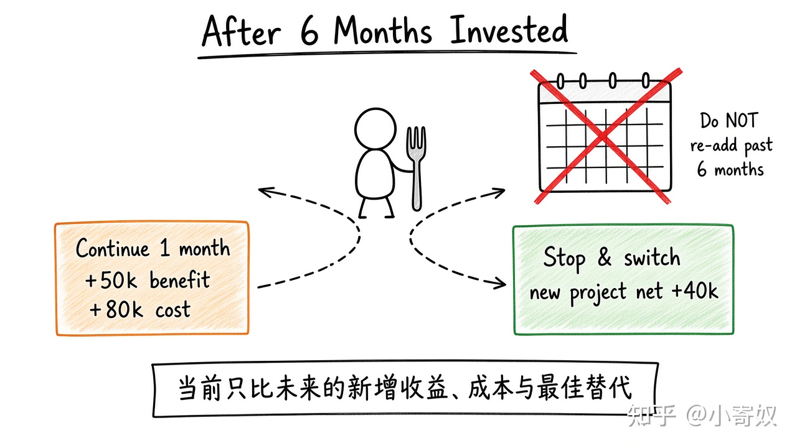

# 知乎发文稿｜02 沉没成本与边际分析

**BOT DRAFT · 未发布 · 需人工审阅**

- 源章节：`../../02_sunk_cost_marginal_analysis.md`（**原文未改**）
- 配图：手绘白板 sketchnote，风格对齐 [高阅读参考文](https://zhuanlan.zhihu.com/p/2070979462934565425)
- 排版节奏：封面图 → 各 h3 标题正下方跟一张图 → 两三句解释

---

## 标题备选（3）

1. 已经砸了很多钱，还该不该继续？沉没成本与边际分析
2. 别用「都投入这么久了」做决定：MB 与 MC 怎么比
3. 模型再训练一小时值不值？用边际思维算清楚

**建议主标题：** 1

---

## 正文（可粘贴知乎）

过去投入很多时，当前决策到底应该比较什么？

先写一句你现在的判断。即使是「不知道」，也先留着。

### 三个术语，先立住

| 中文术语 | English | 缩写 | 通俗解释 |
|---|---|---|---|
| 沉没成本 | Sunk Cost | SC | 已经发生且当前决定无法收回或改变的成本。SC 为便于学习采用的缩写。 |
| 边际收益 | Marginal Benefit | MB | 再增加一单位行动所带来的额外收益。 |
| 边际成本 | Marginal Cost | MC | 再增加一单位行动所带来的额外成本。 |

术语规则：第一次出现时记住「中文（English, 缩写）」；没有公认缩写就写「无通用缩写」。

### 当前该比什么：MB 与 MC

沉没成本（Sunk Cost, SC）是已经发生且当前选择无法收回或改变的成本。过去投入可以用于复盘，但不能单独证明现在应该继续。当前决策要比较从此刻开始的新增收益和新增成本。

边际收益（Marginal Benefit, MB）表示再增加一单位行动带来的额外收益；边际成本（Marginal Cost, MC）表示再增加一单位行动带来的额外成本。最小规则是：当 MB≥MC 时，增加这一单位可能值得；当 MB<MC 时，应停止增加。

### 「已经支付」不等于「全部沉没」

注意：已经支付 ≠ 全部沉没。若一门 3000 元课程退出可退 1000 元，那么不可退的 2000 元是沉没成本，可退的 1000 元仍会被当前决定改变，应纳入比较。

### 最小例子：再训练一小时

模型每多训练 1 小时的 MB 依次是 10、7、4，MC 依次是 3、4、5。第 1、2 小时 MB≥MC，第 3 小时 MB<MC，所以只按这些信息，应训练到第 2 个额外小时。

### 你来做：已投入 6 个月之后

某项目已投入 6 个月。继续一个月：新增收益 5 万元、新增成本 8 万元；停止后团队可做净收益 4 万元的新项目。写出当前比较，不要把过去 6 个月重新加进去。

当前只比未来的新增收益、成本与最佳替代用途。

### 费曼复述

合上材料，用自己的话完成：

> 沉没成本是 ______；当前应比较未来的 ______ 与 ______，并考虑最佳替代用途。

### 适用边界

风险、合同责任、声誉和未来选择权如果会被当前决定改变，就不是沉没成本，仍需纳入未来比较。

---

### 发文注意

- 学习笔记草稿，**非投资建议**；文中金额为教学例子。
- 上传知乎时替换本地图片路径；保持「标题 → 图 → 短文」，不连排配图。
- 水印为「知乎 @小寄奴」。

**BOT DRAFT · 未发布 · 需人工审阅**
