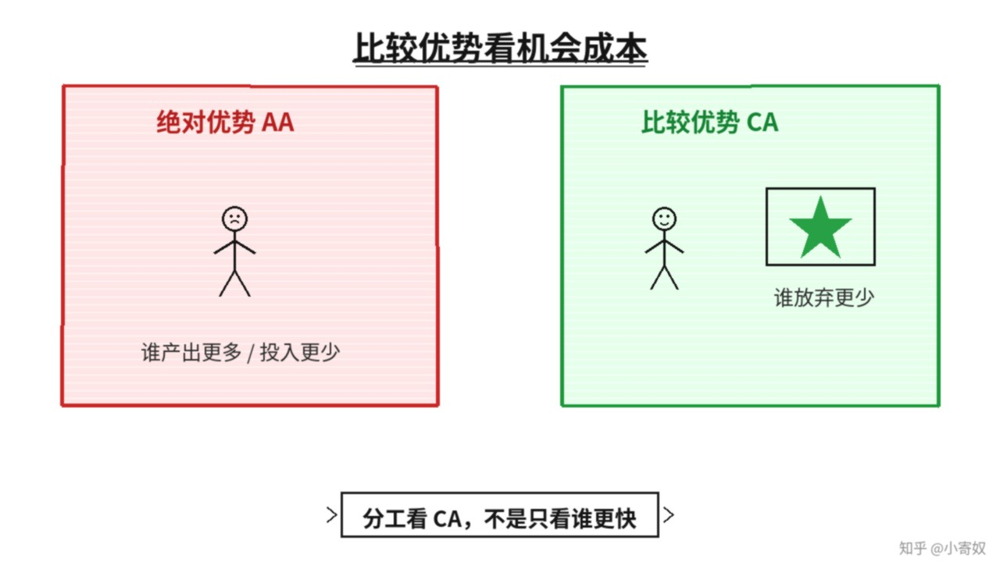

# 01｜绝对优势与比较优势

- 所属单元：Unit 02
- 建议用时：15 分钟
- 本节只解决：**为什么「谁做得更多」不等于「谁更应该做」？**
- 导航：[返回单元首页](README.md) · [下一节](02_specialization_gains_from_trade.md)

## 0～2 分钟：主动回忆

> 为什么「谁做得更多」不等于「谁更应该做」？

## 本节术语

| 中文术语 | English | 缩写 | 通俗解释 |
|---|---|---|---|
| 绝对优势 | Absolute Advantage | AA | 用更少投入生产同样产出，或用同样投入生产更多产出。 |
| 比较优势 | Comparative Advantage | CA | 生产某种产品时机会成本更低。 |
| 机会成本 | Opportunity Cost | OC | 作出选择时，最佳被放弃方案的价值。 |

> 第一次出现记住「中文（English, 缩写）」；无公认缩写就写「无通用缩写」，不要自造。

## 2～9 分钟：核心内容

绝对优势（Absolute Advantage, AA）比较生产率：同样时间谁产出更多，或同样产出谁投入更少。比较优势（Comparative Advantage, CA）比较机会成本：生产某产品时谁放弃的另一种产品更少。

贸易与分工主要由 CA 决定。一个人可能两项都更快，却不该两项都做——把时间用于一项会放弃另一项。分别算「1 单位 A 的 OC」和「1 单位 B 的 OC」。同一个人不可能在两种产品上同时都有 CA；机会成本不同时，每人通常至少有一种相对优势。

## 9～12 分钟：最小例子

甲一天可做 12 个测试或训练 3 个模型：1 个模型成本是 4 个测试。乙可做 8 个测试或训练 4 个模型：1 个模型成本是 2 个测试。甲测试的 OC 较低，乙模型训练的 OC 较低。

## 12～14 分钟：你来做

计算上例中「1 个测试」的机会成本，并写出甲乙在两项任务上的 AA 与 CA。不要只比较绝对产量。

## 14～15 分钟：费曼复述

> AA 比较 ______；CA 比较 ______。分工主要依据 ______，因为它反映真正放弃的产出。

## 适用边界

现实分工还受质量、协作、学习曲线、风险和不可分割任务影响，CA 是起点而非唯一标准。

## 完成证据

- [ ] 能说出本节英文术语与缩写
- [ ] 完成最小例子
- [ ] 保留了自己的判断过程
- [ ] 一句话复述与疑问已写入[工作簿](../workbook.md)
