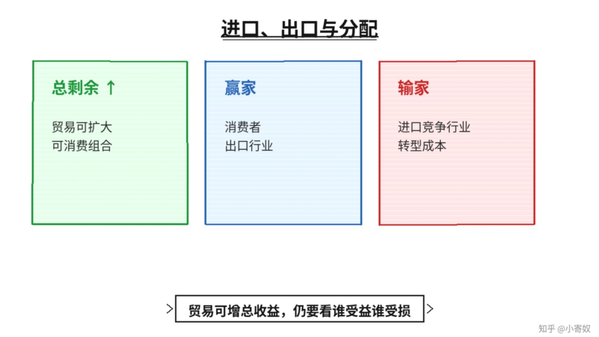

# 03｜进口、出口与贸易的现实边界

- 所属单元：Unit 02
- 建议用时：15 分钟
- 本节只解决：**怎样判断谁出口什么，以及为什么贸易仍可能引发争议？**
- 导航：[上一节](02_specialization_gains_from_trade.md) · [返回单元首页](README.md) · [下一节](04_demand_quantity_demanded.md)

## 0～2 分钟：主动回忆

> 怎样判断谁出口什么，以及为什么贸易仍可能引发争议？

## 本节术语

| 中文术语 | English | 缩写 | 通俗解释 |
|---|---|---|---|
| 进口 | Import | M | 从其他经济体购买的商品或服务。 |
| 出口 | Export | X | 卖给其他经济体的商品或服务。 |
| 贸易条件 | Terms of Trade | ToT | 交易中两种产品相互交换的比率。 |

## 2～9 分钟：核心内容

出口（Export, X）是卖给其他经济体；进口（Import, M）是从其他经济体购买。拥有某产品 CA 的一方倾向出口该产品，并进口机会成本较高的产品。

贸易扩大可消费组合，但改变行业需求与收入分配。区分三问即可（不另开框架）：总体剩余是否增加；收益和损失落在谁身上；是否有低成本方式帮助受损者调整。反对某项贸易可能源于真实分配问题，但不能据此否认比较优势机制。

## 9～12 分钟：最小例子

某地软件服务机会成本低、硬件制造机会成本高，可能出口软件、进口硬件。软件从业者获益，受保护的本地硬件厂可能受损，消费者可能获得更便宜产品。

## 12～14 分钟：你来做

选择一个熟悉产业，列出一种可能出口和一种可能进口的产品，并写出潜在受益者、受损者和转换成本。

## 14～15 分钟：费曼复述

> CA 较低的一方倾向 ______；贸易可能增加总收益，但还要分析 ______ 和 ______。

## 适用边界

国家安全、供应链韧性、环境标准和动态学习效应可能使单纯静态比较优势分析不充分。

## 完成证据

- [ ] 能说出本节英文术语与缩写
- [ ] 完成最小例子
- [ ] 保留了自己的判断过程
- [ ] 一句话复述与疑问已写入[工作簿](../workbook.md)
