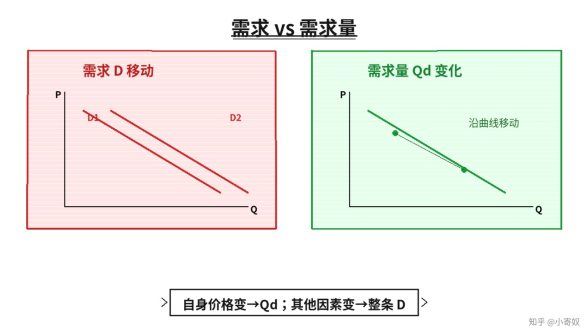

# 04｜需求与需求量

- 所属单元：Unit 02
- 建议用时：15 分钟
- 本节只解决：**价格变化时，为什么要区分「需求变了」和「需求量变了」？**
- 导航：[上一节](03_imports_exports_trade_limits.md) · [返回单元首页](README.md) · [下一节](05_demand_shifters.md)

## 0～2 分钟：主动回忆

> 价格变化时，为什么要区分「需求变了」和「需求量变了」？

## 本节术语

| 中文术语 | English | 缩写 | 通俗解释 |
|---|---|---|---|
| 需求 | Demand | D | 在不同价格下，消费者愿意且能够购买的数量关系。 |
| 需求量 | Quantity Demanded | Qd | 在某一给定价格下愿意且能够购买的具体数量。 |
| 需求定律 | Law of Demand | 无通用缩写 | 其他条件不变时，价格越高，需求量通常越低。 |

## 2～9 分钟：核心内容

需求（Demand, D）是完整价格—数量关系；需求量（Quantity Demanded, Qd）是某一价格下的具体数量。需求定律（Law of Demand，无通用缩写）：其他条件不变时，价格上升，Qd 通常下降。

商品自身价格变化 → 沿同一需求曲线移动（Qd 变化）；收入、偏好、相关商品价格、预期或买者人数变化 → 整条 D 移动。价格下降时说「需求量增加」，不要直接说「需求增加」。

## 9～12 分钟：最小例子

咖啡自身价格从 20 元降到 15 元，沿原 D 曲线移动，Qd 增加。若收入提高并更愿买咖啡，则 D 曲线整体右移。

## 12～14 分钟：你来做

判断：①手机自身价格下降；②消费者更喜欢该品牌；③潜在买家人数增加。分别是 Qd 变化还是 D 移动？

## 14～15 分钟：费曼复述

> 商品自身价格变化导致沿 ______ 移动，即 ______ 变化；其他决定因素变化才使整条 ______ 移动。

## 适用边界

需求曲线表示愿意且能够购买。只有偏好没有支付能力，或只有能力没有购买意愿，都不能形成实际需求。

## 完成证据

- [ ] 能说出本节英文术语与缩写
- [ ] 完成最小例子
- [ ] 保留了自己的判断过程
- [ ] 一句话复述与疑问已写入[工作簿](../workbook.md)
