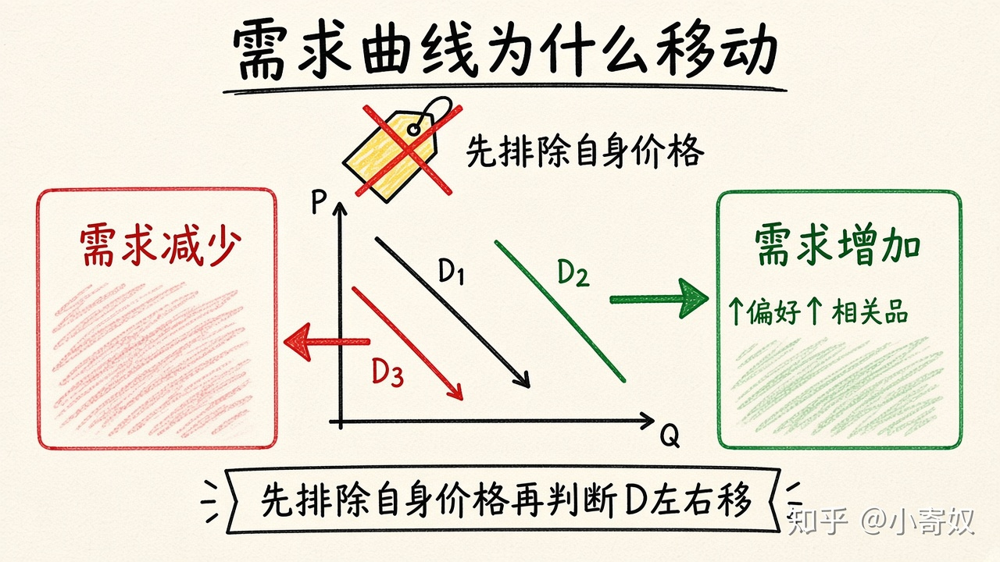

# 05｜需求曲线为什么移动

- 所属单元：Unit 02
- 建议用时：15 分钟
- 本节只解决：**收入和相关商品价格怎样改变整条需求曲线？**
- 导航：[上一节](04_demand_quantity_demanded.md) · [返回单元首页](README.md) · [下一节](06_supply_quantity_supplied.md)

## 0～2 分钟：主动回忆

> 收入和相关商品价格怎样改变整条需求曲线？

## 本节术语

| 中文术语 | English | 缩写 | 通俗解释 |
|---|---|---|---|
| 替代品 | Substitutes | 无通用缩写 | 一种商品价格上涨时，另一种需求通常增加。 |
| 互补品 | Complements | 无通用缩写 | 一种商品价格上涨时，另一种需求通常减少。 |
| 正常品 | Normal Good | 无通用缩写 | 收入增加时需求通常增加的商品。 |
| 低档品 | Inferior Good | 无通用缩写 | 收入增加时需求通常减少；「低档」≠质量差。 |

## 2～9 分钟：核心内容

替代品（Substitutes，无通用缩写）能相互替代：一种价涨，另一种需求通常增。互补品（Complements，无通用缩写）常共同使用：一种价涨，另一种需求通常减。正常品（Normal Good，无通用缩写）收入增则需求增；低档品（Inferior Good，无通用缩写）收入增则需求减。

偏好、预期和买者人数也会移动 D。固定顺序：确认变化的不是自身价格 → 识别影响意愿还是能力 → 判断 D 向左或向右。

## 9～12 分钟：最小例子

汽油价格上涨可能使燃油车需求下降（互补），同时电动车需求上升（替代）。

## 12～14 分钟：你来做

分别判断：收入上升对高端餐厅与方便面；停车费上涨对市中心驾车；竞品大降价对本品牌。

## 14～15 分钟：费曼复述

> 替代品价格上涨使本品需求通常 ______；互补品价格上涨使本品需求通常 ______；收入增加时正常品需求 ______。

## 适用边界

商品类别取决于具体消费者、时间和场景。同一商品对不同收入群体可能呈现不同性质。

## 完成证据

- [ ] 能说出本节英文术语与缩写
- [ ] 完成最小例子
- [ ] 保留了自己的判断过程
- [ ] 一句话复述与疑问已写入[工作簿](../workbook.md)
