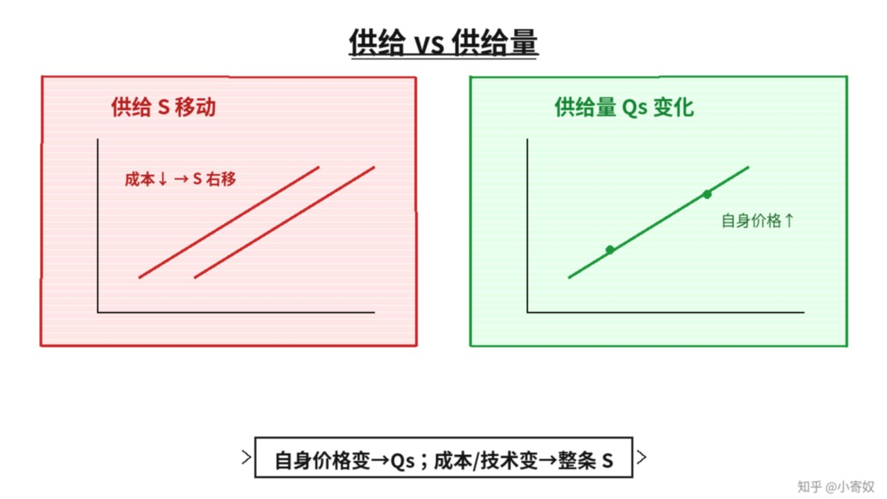

# 06｜供给、供给量与供给曲线移动

- 所属单元：Unit 02
- 建议用时：15 分钟
- 本节只解决：**生产成本下降时，为什么是供给曲线移动，而不是供给量变化？**
- 导航：[上一节](05_demand_shifters.md) · [返回单元首页](README.md) · [下一节](07_equilibrium_surplus_shortage.md)

## 0～2 分钟：主动回忆

> 生产成本下降时，为什么是供给曲线移动，而不是供给量变化？

## 本节术语

| 中文术语 | English | 缩写 | 通俗解释 |
|---|---|---|---|
| 供给 | Supply | S | 在不同价格下，生产者愿意且能够出售的数量关系。 |
| 供给量 | Quantity Supplied | Qs | 在某一给定价格下愿意且能够出售的具体数量。 |
| 供给定律 | Law of Supply | 无通用缩写 | 其他条件不变时，价格越高，供给量通常越高。 |

## 2～9 分钟：核心内容

供给（Supply, S）是完整价格—出售量关系；供给量（Quantity Supplied, Qs）是给定价格下的具体数量。供给定律（Law of Supply，无通用缩写）：其他条件不变时，价格越高，Qs 通常越大。

自身价格变化 → 沿 S 移动；投入品价格、技术、预期、卖者数量、税收补贴和自然条件 → 整条 S 移动。成本下降使每个售价下生产都更有利，S 右移——不是「价格不变但沿曲线增加」。

## 9～12 分钟：最小例子

关键芯片降价降低智能设备成本，各售价下企业愿生产更多，S 右移。若设备自身价格上涨，则沿原 S 向右上移动，Qs 增加。

## 12～14 分钟：你来做

判断：①工资上涨；②自动化提高效率；③商品自身价格下降；④更多企业进入。分别影响 S 还是 Qs，方向如何？

## 14～15 分钟：费曼复述

> 自身价格变化导致 ______ 变化；成本、技术和卖者数量变化导致整条 ______ 移动。

## 适用边界

短期内产能可能受限，供给反应较小；长期企业能调整设备与进入退出，供给通常更灵活。

## 完成证据

- [ ] 能说出本节英文术语与缩写
- [ ] 完成最小例子
- [ ] 保留了自己的判断过程
- [ ] 一句话复述与疑问已写入[工作簿](../workbook.md)
