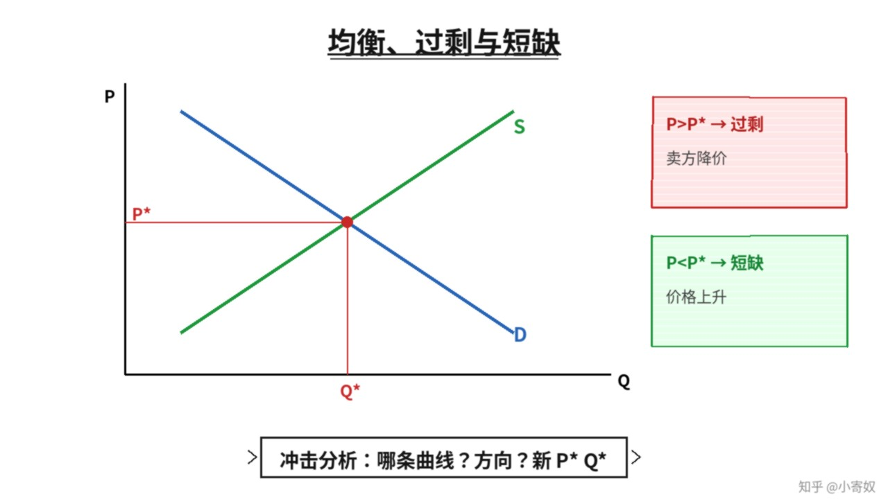

# 07｜均衡、过剩与短缺

- 所属单元：Unit 02
- 建议用时：15 分钟
- 本节只解决：**供给与需求怎样共同决定价格和交易数量？**
- 导航：[上一节](06_supply_quantity_supplied.md) · [返回单元首页](README.md) · [下一节](08_unit_review.md)

## 0～2 分钟：主动回忆

> 供给与需求怎样共同决定价格和交易数量？

## 本节术语

| 中文术语 | English | 缩写 | 通俗解释 |
|---|---|---|---|
| 均衡 | Equilibrium | Eq. | 买方计划购买量与卖方计划出售量相等的状态。 |
| 均衡价格 | Equilibrium Price | P* | 使需求量与供给量相等的价格。 |
| 均衡数量 | Equilibrium Quantity | Q* | 均衡价格下实际交易的数量。 |
| 过剩 | Surplus | 无通用缩写 | 供给量大于需求量。 |
| 短缺 | Shortage | 无通用缩写 | 需求量大于供给量。 |

## 2～9 分钟：核心内容

均衡（Equilibrium, Eq.）是 Qd=Qs。均衡价格（Equilibrium Price, P*）使买卖双方计划量相等；均衡数量（Equilibrium Quantity, Q*）是该价下的交易量。

价格高于 P* → Qs>Qd → 过剩（Surplus，无通用缩写）→ 降价压力；低于 P* → 短缺（Shortage，无通用缩写）→ 涨价压力。冲击三步：判断 D 还是 S 移动 → 方向 → 比较新旧 P* 与 Q*。

## 9～12 分钟：最小例子

芯片成本下降使 S 右移，若 D 不变，新均衡通常价格下降、数量上升。偏好增强使 D 右移，若 S 不变，价格和数量通常都上升。

## 12～14 分钟：你来做

分析「收入增加且产品为正常品」以及「关键原料涨价」。分别描述 D/S 移动，并判断 P*、Q*。

## 14～15 分钟：费曼复述

> 均衡满足 ______；价格高于 P* 出现 ______，低于 P* 出现 ______。冲击分析先判断哪条曲线移动。

## 适用边界

若供给与需求同时移动，价格或数量的一项可能方向不确定，需要比较移动幅度。

## 完成证据

- [ ] 能说出本节英文术语与缩写
- [ ] 完成最小例子
- [ ] 保留了自己的判断过程
- [ ] 一句话复述与疑问已写入[工作簿](../workbook.md)
