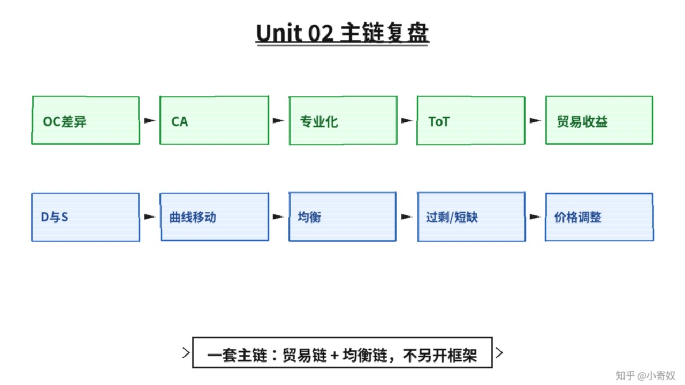

# 08｜单元复盘：从比较优势到市场均衡

- 所属单元：Unit 02
- 建议用时：15 分钟
- 本节只解决：**能否用机会成本和供求图解释一个真实市场？**
- 导航：[上一节](07_equilibrium_surplus_shortage.md) · [返回单元首页](README.md)

## 0～2 分钟：主动回忆

> 能否用机会成本和供求图解释一个真实市场？

## 本节术语（复用）

| 中文术语 | English | 缩写 |
|---|---|---|
| 比较优势 | Comparative Advantage | CA |
| 需求 | Demand | D |
| 供给 | Supply | S |
| 均衡 | Equilibrium | Eq. |

## 2～9 分钟：核心内容

闭卷回忆这一条主线（**一套流程，不要另起平行方案**）：



```text
机会成本差异 → 比较优势 → 专业化 → 贸易条件 → 贸易收益
→ 需求与供给 → 曲线移动 → 均衡 → 过剩/短缺 → 价格调整
```

选「汽车芯片」「电动车」「AI 订阅服务」之一：写出买方、卖方、D/S 主要决定因素，设计一个需求冲击和一个供给冲击，并判断 P* 与 Q*。

## 9～12 分钟：最小例子

电动车补贴提高购买意愿，D 右移；电池技术进步降低成本，S 右移。两者同时发生时，Q* 明确上升，而 P* 取决于两条曲线移动幅度。

## 12～14 分钟：你来做

10 分钟内：①完成一组 CA 计算；②判断四个事件是曲线移动还是沿曲线移动；③分析一个同时发生的供需冲击；④用 1 分钟讲清。

## 14～15 分钟：费曼复述

> 比较优势解释 ______；需求和供给共同决定 ______；同时冲击时必须比较 ______。

## 适用边界

本单元使用竞争市场模型。垄断、信息不对称、外部性和政策约束会在后续单元加入。

## 完成证据

- [ ] 能说出本节英文术语与缩写
- [ ] 完成最小例子
- [ ] 保留了自己的判断过程
- [ ] 一句话复述与疑问已写入[工作簿](../workbook.md)
