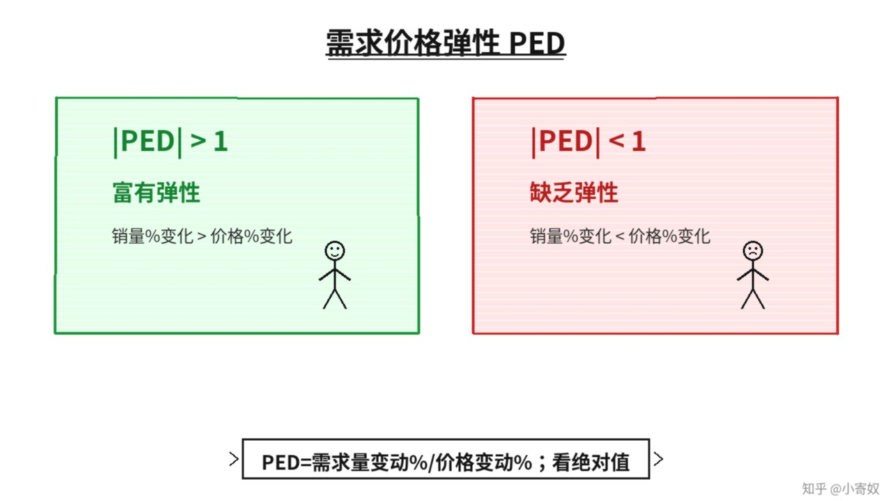

# 01｜需求价格弹性：敏感程度

- 所属单元：Unit 03
- 建议用时：15 分钟
- 本节只解决：**同样涨价 10%，为什么不同商品的销量反应完全不同？**
- 导航：[返回单元首页](README.md) · [下一节](02_midpoint_method.md)

## 0～2 分钟：主动回忆

> 同样涨价 10%，为什么不同商品的销量反应完全不同？

## 本节术语

| 中文术语 | English | 缩写 | 通俗解释 |
|---|---|---|---|
| 需求价格弹性 | Price Elasticity of Demand | PED | 需求量对价格变化的敏感程度。 |
| 富有弹性 | Elastic Demand | 绝对值>1 | 需求量变动百分比大于价格变动百分比。 |
| 缺乏弹性 | Inelastic Demand | 绝对值<1 | 需求量变动百分比小于价格变动百分比。 |

> 第一次出现记住「中文（English, 缩写）」；无公认缩写就写「无通用缩写」，不要自造。

## 2～9 分钟：核心内容

需求价格弹性（Price Elasticity of Demand, PED）衡量需求量对价格变化的敏感程度：

$$
PED=\frac{需求量变动百分比}{价格变动百分比}
$$

需求曲线通常向下，PED 原始值常为负；比较敏感程度时用绝对值。|PED|>1 富有弹性；|PED|<1 缺乏弹性；等于 1 为单位弹性。替代品越多、越非必需、市场定义越窄、调整时间越长，需求往往越有弹性。弹性是百分比之比，无单位，可跨商品比较。

## 9～12 分钟：最小例子

价格上涨 10%、销量下降 20%，|PED|=2，富有弹性。价格上涨 10%、销量只下降 3%，|PED|=0.3，缺乏弹性。

## 12～14 分钟：你来做

判断：①胰岛素短期需求；②某一具体品牌矿泉水；③汽油短期与长期。哪个更有弹性？理由是什么？

## 14～15 分钟：费曼复述

> PED 衡量 ______ 对 ______ 的敏感程度；|PED|>1 表示 ______，|PED|<1 表示 ______。

## 适用边界

弹性取决于市场定义和时间范围。「汽车」的弹性与「某品牌某型号汽车」的弹性不同。

## 完成证据

- [ ] 能说出本节英文术语与缩写
- [ ] 完成最小例子
- [ ] 保留了自己的判断过程
- [ ] 一句话复述与疑问已写入[工作簿](../workbook.md)
