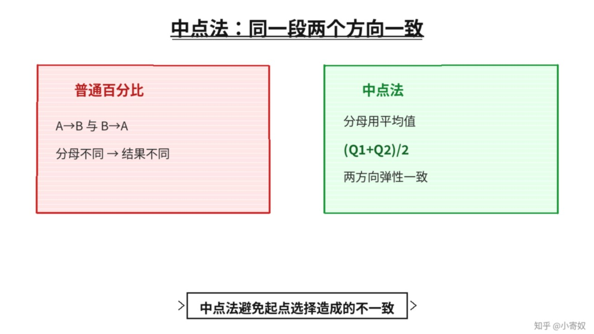

# 02｜中点法计算弹性

- 所属单元：Unit 03
- 建议用时：15 分钟
- 本节只解决：**为什么不能用不同起点计算出两种不一致的弹性？**
- 导航：[上一节](01_ped_concept.md) · [返回单元首页](README.md) · [下一节](03_ped_total_revenue.md)

## 0～2 分钟：主动回忆

> 为什么不能用不同起点计算出两种不一致的弹性？

## 本节术语

| 中文术语 | English | 缩写 | 通俗解释 |
|---|---|---|---|
| 中点法 | Midpoint Method | 无通用缩写 | 用变化前后平均值作为基准计算百分比变化。 |
| 需求价格弹性 | Price Elasticity of Demand | PED | 需求量对价格变化的敏感程度。 |
| 单位弹性 | Unit-elastic Demand | 绝对值=1 | 需求量变动百分比等于价格变动百分比。 |

## 2～9 分钟：核心内容

普通百分比以起点为分母，从 A 到 B 与从 B 到 A 会得到不同结果。中点法（Midpoint Method，无通用缩写）用平均值作分母，两方向得到同样弹性。

$$
\%\Delta Q=\frac{Q_2-Q_1}{(Q_1+Q_2)/2}
\qquad
\%\Delta P=\frac{P_2-P_1}{(P_1+P_2)/2}
\qquad
PED=\frac{\%\Delta Q}{\%\Delta P}
$$

先保留正负号理解方向，分类时取绝对值。弹性没有「元/件」单位。

## 9～12 分钟：最小例子

价格 100→120，销量 1000→800：

$$
\%\Delta Q=\frac{-200}{900}=-22.22\%
\qquad
\%\Delta P=\frac{20}{110}=18.18\%
$$

PED≈-1.22，|PED|>1，富有弹性。

## 12～14 分钟：你来做

价格 50→60，销量 600→500。用中点法完整计算 |PED|，写出每一步百分比并分类。

## 14～15 分钟：费曼复述

> 中点法用 ______ 作为分母，避免从 A 到 B 与从 B 到 A 结果 ______；分类时看 PED 的 ______。

## 适用边界

中点法适合两点间离散变化。若有完整函数可用点弹性，本课程先掌握中点法。

## 完成证据

- [ ] 能说出本节英文术语与缩写
- [ ] 完成最小例子
- [ ] 保留了自己的判断过程
- [ ] 一句话复述与疑问已写入[工作簿](../workbook.md)
