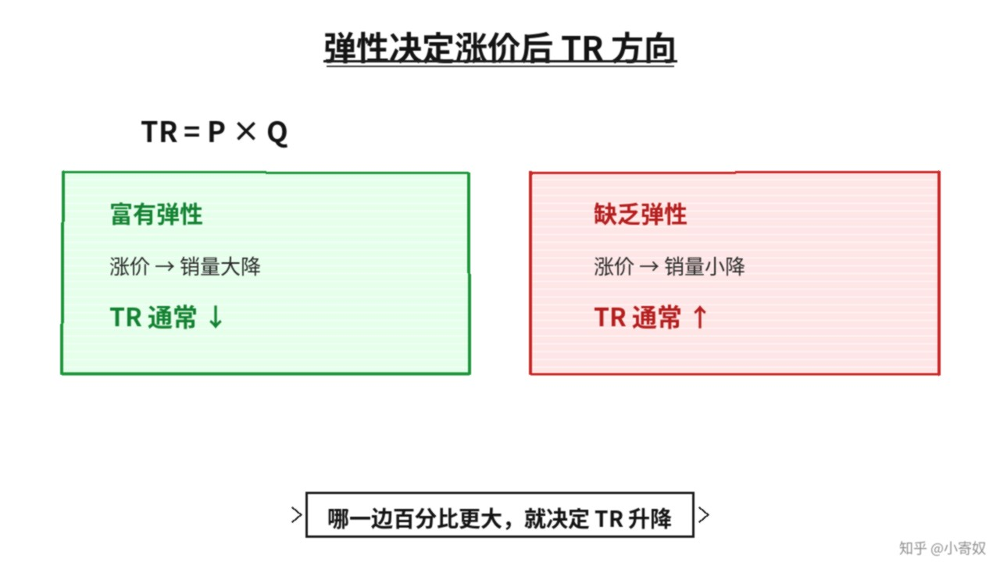

# 03｜需求弹性与总收益

- 所属单元：Unit 03
- 建议用时：15 分钟
- 本节只解决：**为什么涨价有时增加收入，有时反而减少收入？**
- 导航：[上一节](02_midpoint_method.md) · [返回单元首页](README.md) · [下一节](04_income_cross_elasticity.md)

## 0～2 分钟：主动回忆

> 为什么涨价有时增加收入，有时反而减少收入？

## 本节术语

| 中文术语 | English | 缩写 | 通俗解释 |
|---|---|---|---|
| 总收益 | Total Revenue | TR | 销售收入，TR=P×Q。 |
| 需求价格弹性 | Price Elasticity of Demand | PED | 需求量对价格变化的敏感程度。 |
| 富有弹性 | Elastic Demand | 绝对值>1 | 需求量变动百分比大于价格变动百分比。 |
| 缺乏弹性 | Inelastic Demand | 绝对值<1 | 需求量变动百分比小于价格变动百分比。 |

## 2～9 分钟：核心内容

总收益（Total Revenue, TR）等于价格乘销量：TR=P×Q。涨价有两个相反作用：每件收入提高，但销量下降——哪一边更强取决于 PED。

富有弹性：销量百分比下降更大，涨价通常使 TR 下降。缺乏弹性：销量下降较小，涨价通常使 TR 上升。单位弹性附近 TR 变化较小。降价方向相反。

## 9～12 分钟：最小例子

原价 100 元、销量 1000，TR=100000。涨到 120 元、销量 800，TR=96000。前一节 |PED|≈1.22，富有弹性，涨价后 TR 下降。

## 12～14 分钟：你来做

价格 20→22 元，销量 1000→980。先比较新旧 TR，再估算需求更可能富有还是缺乏弹性。

## 14～15 分钟：费曼复述

> TR=______。需求富有弹性时，涨价通常使 TR ______；缺乏弹性时，涨价通常使 TR ______。

## 适用边界

TR 不是利润。即使 TR 增加，成本也可能上升；定价最终要结合边际成本、竞争和长期反应。

## 完成证据

- [ ] 能说出本节英文术语与缩写
- [ ] 完成最小例子
- [ ] 保留了自己的判断过程
- [ ] 一句话复述与疑问已写入[工作簿](../workbook.md)
