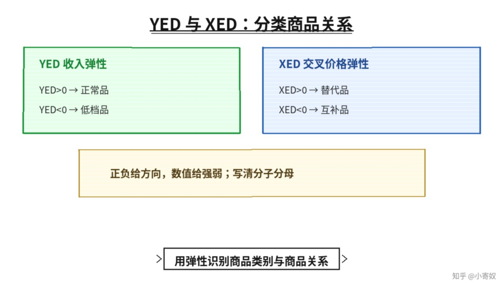

# 04｜收入弹性与交叉价格弹性

- 所属单元：Unit 03
- 建议用时：15 分钟
- 本节只解决：**怎样用弹性识别商品类别和商品之间的关系？**
- 导航：[上一节](03_ped_total_revenue.md) · [返回单元首页](README.md) · [下一节](05_pes_time_horizon.md)

## 0～2 分钟：主动回忆

> 怎样用弹性识别商品类别和商品之间的关系？

## 本节术语

| 中文术语 | English | 缩写 | 通俗解释 |
|---|---|---|---|
| 收入弹性 | Income Elasticity of Demand | YED | 需求量对消费者收入变化的敏感程度。 |
| 交叉价格弹性 | Cross-price Elasticity of Demand | XED | 一种商品需求量对另一种商品价格变化的敏感程度。 |
| 正常品 | Normal Good | 无通用缩写 | 收入增加时需求通常增加。 |
| 低档品 | Inferior Good | 无通用缩写 | 收入增加时需求通常减少。 |
| 替代品 | Substitutes | 无通用缩写 | 一种价格上涨时，另一种需求通常增加。 |
| 互补品 | Complements | 无通用缩写 | 一种价格上涨时，另一种需求通常减少。 |

## 2～9 分钟：核心内容

收入弹性（Income Elasticity of Demand, YED）：需求量变动%/收入变动%。YED>0 通常正常品，YED<0 通常低档品。交叉价格弹性（Cross-price Elasticity of Demand, XED）：A 需求量变动%/B 价格变动%。XED>0 更像替代品；XED<0 更像互补品。

正负给方向，数值给强弱；必须写清分子、分母和商品顺序。

## 9～12 分钟：最小例子

汽油价涨 10%、电动车需求增 5%，XED=0.5（替代）。汽油价涨 10%、燃油车需求降 8%，XED=-0.8（互补）。

## 12～14 分钟：你来做

收入上升 8%，方便面需求下降 4%；竞品价格上涨 10%，本品牌需求上升 6%。分别算 YED、XED 并判断类别。

## 14～15 分钟：费曼复述

> YED 的正负帮助区分 ______ 与 ______；XED>0 常表示 ______，XED<0 常表示 ______。

## 适用边界

统计关系随人群、时间和产品定义变化。正负号帮助分类，不能替代具体市场理解。

## 完成证据

- [ ] 能说出本节英文术语与缩写
- [ ] 完成最小例子
- [ ] 保留了自己的判断过程
- [ ] 一句话复述与疑问已写入[工作簿](../workbook.md)
