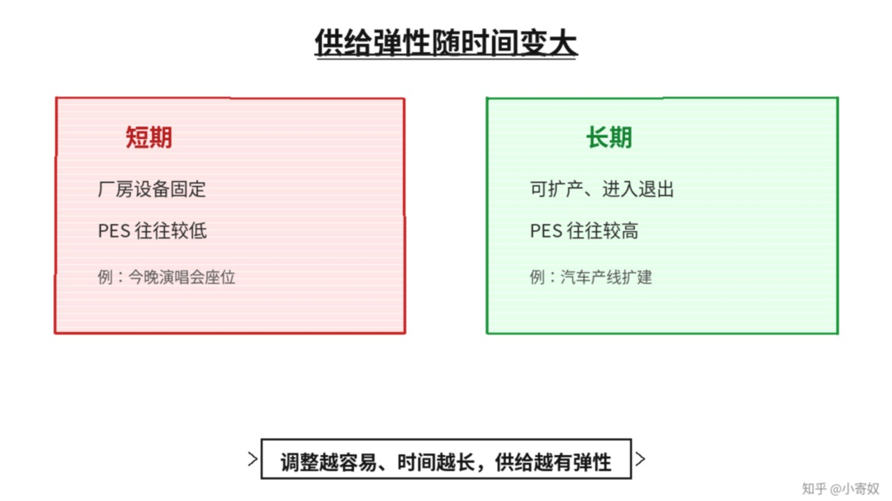

# 05｜供给价格弹性与时间

- 所属单元：Unit 03
- 建议用时：15 分钟
- 本节只解决：**为什么企业短期很难增产，长期却可能反应很大？**
- 导航：[上一节](04_income_cross_elasticity.md) · [返回单元首页](README.md) · [下一节](06_price_controls.md)

## 0～2 分钟：主动回忆

> 为什么企业短期很难增产，长期却可能反应很大？

## 本节术语

| 中文术语 | English | 缩写 | 通俗解释 |
|---|---|---|---|
| 供给价格弹性 | Price Elasticity of Supply | PES | 供给量对价格变化的敏感程度。 |
| 供给量 | Quantity Supplied | Qs | 在某一给定价格下愿意且能够出售的具体数量。 |
| 边际成本 | Marginal Cost | MC | 再增加一单位行动的额外成本。 |

## 2～9 分钟：核心内容

供给价格弹性（Price Elasticity of Supply, PES）= 供给量变动%/价格变动%。供给通常随价格同向，PES 多为正。关键决定因素：产能闲置、库存、生产周期、投入可得性、进入退出难度。

短期厂房设备固定，PES 往往较低；长期可扩产、调技术、进入市场，PES 往往较高。土地、名画等总量固定物品，供给可能接近完全无弹性。

## 9～12 分钟：最小例子

演唱会当晚座位固定，票价上涨也无法增加座位，短期 PES 接近 0。汽车价格长期上升后，厂商可扩建产线，长期 PES 更高。

## 12～14 分钟：你来做

比较鲜鱼、软件复制、城市核心土地的短期弹性；再说明一年后为何可能不同。

## 14～15 分钟：费曼复述

> PES 衡量 ______ 对价格的敏感程度；产能调整越容易、时间越长，供给通常越 ______。

## 适用边界

数字产品复制成本低不等于供给无限，研发、服务器、渠道和版权仍可能形成容量约束。

## 完成证据

- [ ] 能说出本节英文术语与缩写
- [ ] 完成最小例子
- [ ] 保留了自己的判断过程
- [ ] 一句话复述与疑问已写入[工作簿](../workbook.md)
