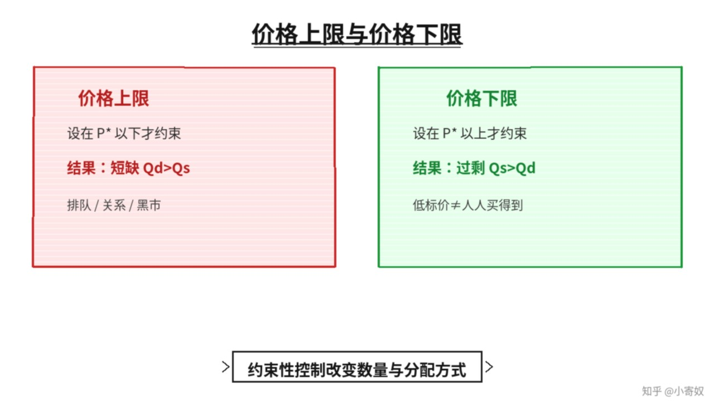

# 06｜价格上限与价格下限

- 所属单元：Unit 03
- 建议用时：15 分钟
- 本节只解决：**政府规定价格后，为什么低价不一定让所有买家受益？**
- 导航：[上一节](05_pes_time_horizon.md) · [返回单元首页](README.md) · [下一节](07_tax_incidence.md)

## 0～2 分钟：主动回忆

> 政府规定价格后，为什么低价不一定让所有买家受益？

## 本节术语

| 中文术语 | English | 缩写 | 通俗解释 |
|---|---|---|---|
| 价格上限 | Price Ceiling | 无通用缩写 | 政府规定的法定最高价格。 |
| 价格下限 | Price Floor | 无通用缩写 | 政府规定的法定最低价格。 |
| 短缺 | Shortage | 无通用缩写 | 需求量大于供给量。 |
| 过剩 | Surplus | 无通用缩写 | 供给量大于需求量。 |

## 2～9 分钟：核心内容

价格上限（Price Ceiling，无通用缩写）是法定最高价；设在均衡价以下才有约束力，此时 Qd>Qs，形成短缺。价格下限（Price Floor，无通用缩写）是法定最低价；设在均衡价以上才有约束力，形成过剩。

短缺时商品不会自动平均分配：可能排队、关系、抽签、质量下降、附加费用和黑市。受益的是以低价成功获得商品的人；找不到商品的人可能更差。长期供需更有弹性，数量缺口往往更明显。

## 9～12 分钟：最小例子

租金上限低于均衡租金，成功续租者可能受益，但房东减少维护、新建减少、寻租时间增加，部分潜在租客反而受损。

## 12～14 分钟：你来做

画出一个约束性租金上限：标出 P*、上限、Qd、Qs 和短缺。再写出两种非价格分配方式。

## 14～15 分钟：费曼复述

> 约束性价格上限导致 ______；约束性价格下限导致 ______。低标价不等于每个人都能 ______。

## 适用边界

实际效果依赖执法、豁免、质量、配给方式和长期供给反应，不能只看标价。

## 完成证据

- [ ] 能说出本节英文术语与缩写
- [ ] 完成最小例子
- [ ] 保留了自己的判断过程
- [ ] 一句话复述与疑问已写入[工作簿](../workbook.md)
