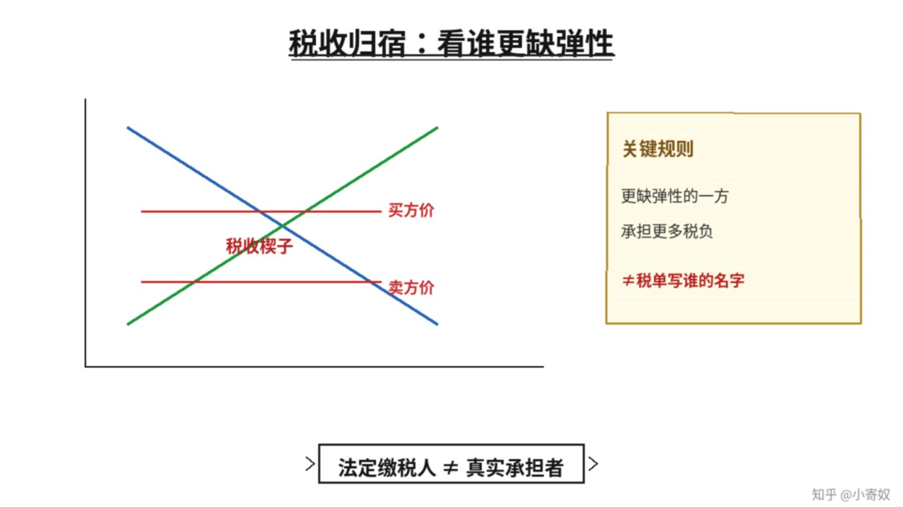

# 07｜税收楔子与税收归宿

- 所属单元：Unit 03
- 建议用时：15 分钟
- 本节只解决：**法律规定谁缴税，为什么不等于谁真正承担税负？**
- 导航：[上一节](06_price_controls.md) · [返回单元首页](README.md) · [下一节](08_unit_review.md)

## 0～2 分钟：主动回忆

> 法律规定谁缴税，为什么不等于谁真正承担税负？

## 本节术语

| 中文术语 | English | 缩写 | 通俗解释 |
|---|---|---|---|
| 税收楔子 | Tax Wedge | 无通用缩写 | 买方支付价与卖方实际获得价之间的差额。 |
| 税收归宿 | Tax Incidence | 无通用缩写 | 税负最终由消费者和生产者如何分担。 |
| 需求价格弹性 | Price Elasticity of Demand | PED | 需求量对价格变化的敏感程度。 |
| 供给价格弹性 | Price Elasticity of Supply | PES | 供给量对价格变化的敏感程度。 |

## 2～9 分钟：核心内容

税收楔子（Tax Wedge，无通用缩写）使买方支付价高于卖方所得价。税收归宿（Tax Incidence，无通用缩写）讨论这段税负如何在买卖双方之间分担。

关键不是税单写谁的名字，而是谁更难改变行为。需求越缺弹性，消费者承担越多；供给越缺弹性，生产者承担越多。相对更缺弹性的一方承担更多。税同时降低交易数量，并可能产生无谓损失（后续单元展开）。

## 9～12 分钟：最小例子

某药品需求很缺弹性、供给很有弹性。征税后消费者仍需购买，厂商更容易转移资源，消费者通常承担较多税负。

## 12～14 分钟：你来做

分析「城市核心土地供给极不弹性、住房需求较有弹性」的税收。哪一方承担更多？不要根据法律缴税人判断。

## 14～15 分钟：费曼复述

> 税收归宿取决于双方的相对 ______；更难改变数量、也就是更 ______ 的一方承担更多。

## 适用边界

短期与长期弹性不同，税负分配也可能随时间改变。市场势力和规避行为会让简单模型需要调整。

## 完成证据

- [ ] 能说出本节英文术语与缩写
- [ ] 完成最小例子
- [ ] 保留了自己的判断过程
- [ ] 一句话复述与疑问已写入[工作簿](../workbook.md)
