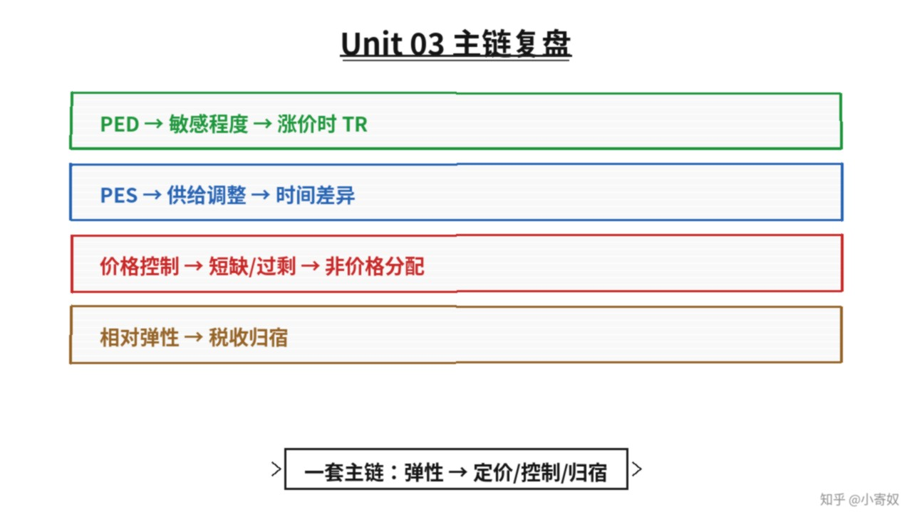

# 08｜单元复盘：弹性与政策三步分析

- 所属单元：Unit 03
- 建议用时：15 分钟
- 本节只解决：**能否计算弹性，并把它用于定价和政策判断？**
- 导航：[上一节](07_tax_incidence.md) · [返回单元首页](README.md)

## 0～2 分钟：主动回忆

> 能否计算弹性，并把它用于定价和政策判断？

## 本节术语（复用）

| 中文术语 | English | 缩写 |
|---|---|---|
| 需求价格弹性 | Price Elasticity of Demand | PED |
| 总收益 | Total Revenue | TR |
| 价格上限 | Price Ceiling | 无通用缩写 |
| 税收归宿 | Tax Incidence | 无通用缩写 |

## 2～9 分钟：核心内容

闭卷回忆这一条主线（**一套流程，不要另起平行方案**）：



```text
PED → 敏感程度 → 涨价时 TR 方向
PES → 供给调整能力 → 时间差异
价格控制 → 短缺或过剩 → 非价格分配
相对弹性 → 税收归宿
```

政策分析固定三步：先画无政策均衡；再加入上限、下限或税收楔子；最后分析数量变化、受益者、受损者和长期适应。

## 9～12 分钟：最小例子

若需求缺弹性、供给富有弹性，税负更多落在消费者；若长期替代品出现，需求弹性可能增大，税负分配会变化。

## 12～14 分钟：你来做

10 分钟内：①用中点法算 PED；②比较 TR；③画约束性价格上限；④判断一项税收归宿；⑤用 1 分钟讲清「弹性就是调整能力」。

## 14～15 分钟：费曼复述

> 弹性衡量 ______；它连接了定价、总收益、价格控制和 ______ 的判断。

## 适用边界

本单元主要分析局部均衡与短期机制。公平、总福利和无谓损失将在下一单元展开。

## 完成证据

- [ ] 能说出本节英文术语与缩写
- [ ] 完成最小例子
- [ ] 保留了自己的判断过程
- [ ] 一句话复述与疑问已写入[工作簿](../workbook.md)
