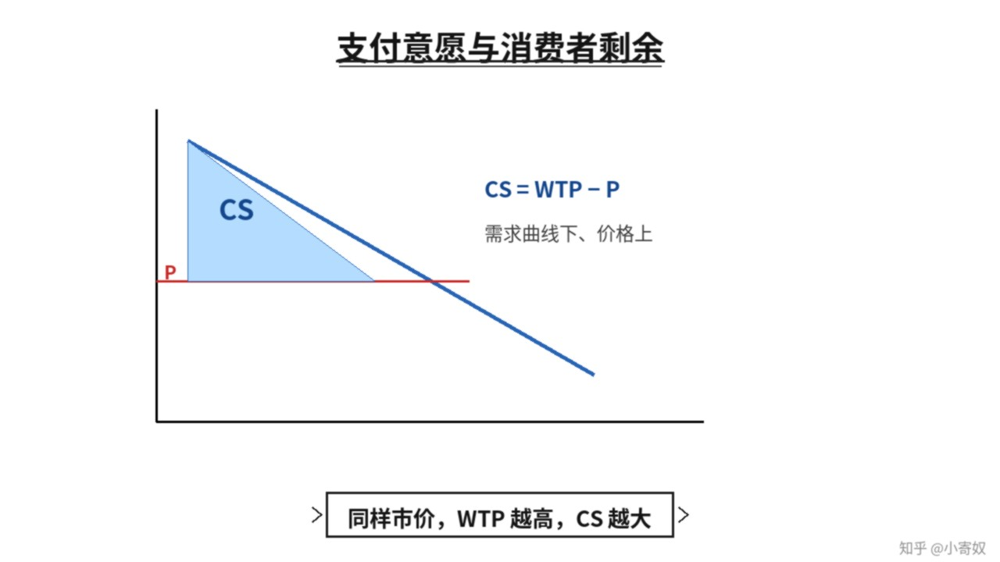

# 01｜支付意愿与消费者剩余

- 所属单元：Unit 04
- 建议用时：15 分钟
- 本节只解决：**为什么同样的市场价格，会让不同消费者获得不同程度的「划算感」？**
- 导航：[返回单元首页](README.md) · [下一节](02_seller_cost_producer_surplus.md)

## 0～2 分钟：主动回忆

> 为什么同样的市场价格，会让不同消费者获得不同程度的「划算感」？

## 本节术语

| 中文术语 | English | 缩写 | 通俗解释 |
|---|---|---|---|
| 支付意愿 | Willingness to Pay | WTP | 消费者购买某单位商品愿意支付的最高金额。 |
| 消费者剩余 | Consumer Surplus | CS | 支付意愿减去实际支付价格。 |
| 需求 | Demand | D | 在不同价格下，消费者愿意且能够购买的数量关系。 |

> 第一次出现记住「中文（English, 缩写）」；无公认缩写就写「无通用缩写」，不要自造。

## 2～9 分钟：核心内容

支付意愿（Willingness to Pay, WTP）是消费者愿意为某单位商品支付的最高金额。需求曲线可理解为不同边际单位的 WTP 排列。

消费者剩余（Consumer Surplus, CS）= WTP − 实际支付价格。最多愿付 100 元、实际价 60 元，则 CS=40 元。市场总 CS 在图上是需求曲线下方、市场价格上方的面积。降价通常让原有买家每单位获得更多 CS，也可能让新买家进入。

## 9～12 分钟：最小例子

三位用户 WTP 分别为 100、80、50 元，市场价 60 元。前两位购买，CS 分别 40、20，总 CS=60 元；第三位不购买。

## 12～14 分钟：你来做

给定 WTP：120、90、70、40 元，市场价 75 元。谁购买？分别计算 CS 和总 CS。

## 14～15 分钟：费曼复述

> WTP 是 ______；CS=______−______，图上位于 ______ 曲线与价格之间。

## 适用边界

WTP 受收入、信息、偏好和情境影响。它衡量私人价值，不自动包含对他人的外部影响。

## 完成证据

- [ ] 能说出本节英文术语与缩写
- [ ] 完成最小例子
- [ ] 保留了自己的判断过程
- [ ] 一句话复述与疑问已写入[工作簿](../workbook.md)
