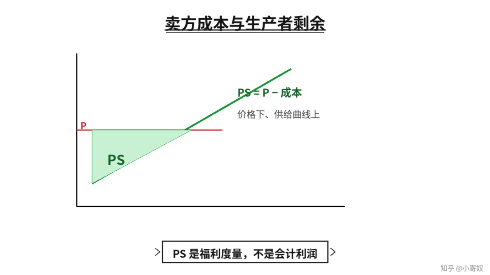

# 02｜卖方成本与生产者剩余

- 所属单元：Unit 04
- 建议用时：15 分钟
- 本节只解决：**卖方接受一个价格时，真正获得的收益如何衡量？**
- 导航：[上一节](01_wtp_consumer_surplus.md) · [返回单元首页](README.md) · [下一节](03_total_surplus_efficiency_equity.md)

## 0～2 分钟：主动回忆

> 卖方接受一个价格时，真正获得的收益如何衡量？

## 本节术语

| 中文术语 | English | 缩写 | 通俗解释 |
|---|---|---|---|
| 生产者剩余 | Producer Surplus | PS | 卖方实际获得价格减去其机会成本。 |
| 供给 | Supply | S | 在不同价格下，生产者愿意且能够出售的数量关系。 |
| 机会成本 | Opportunity Cost | OC | 作出选择时，最佳被放弃方案的价值。 |

## 2～9 分钟：核心内容

卖方成本在福利分析中通常指生产该单位所放弃的机会成本。供给曲线可理解为不同边际单位的最低可接受价格。

生产者剩余（Producer Surplus, PS）= 实际获得价格 − 成本。机会成本 40 元、市场支付 70 元，则 PS=30 元。市场总 PS 是市场价格下方、供给曲线上方的面积。价格上升通常增加原有卖方每单位 PS，也可能吸引成本更高的生产者进入。

## 9～12 分钟：最小例子

四个卖方成本为 20、40、60、90 元，市场价 65 元。前三个成交，PS 分别 45、25、5，总 PS=75 元。

## 12～14 分钟：你来做

卖方成本为 30、50、80、110 元，价格为 85 元。判断谁成交并计算总 PS。

## 14～15 分钟：费曼复述

> PS=______−______；供给曲线可理解为卖方的 ______ 价格。

## 适用边界

PS 不是会计利润。它是一种福利度量，具体核算还要处理固定成本、隐性成本和时间范围。

## 完成证据

- [ ] 能说出本节英文术语与缩写
- [ ] 完成最小例子
- [ ] 保留了自己的判断过程
- [ ] 一句话复述与疑问已写入[工作簿](../workbook.md)
