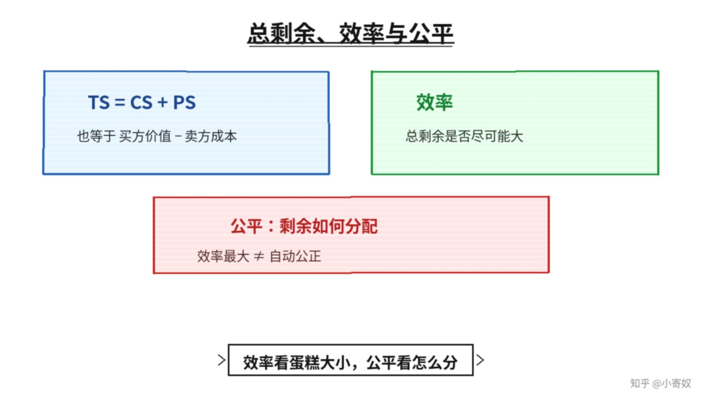

# 03｜总剩余、效率与公平

- 所属单元：Unit 04
- 建议用时：15 分钟
- 本节只解决：**竞争市场为什么可能最大化交易收益，却不自动保证公平？**
- 导航：[上一节](02_seller_cost_producer_surplus.md) · [返回单元首页](README.md) · [下一节](04_tax_dwl.md)

## 0～2 分钟：主动回忆

> 竞争市场为什么可能最大化交易收益，却不自动保证公平？

## 本节术语

| 中文术语 | English | 缩写 | 通俗解释 |
|---|---|---|---|
| 总剩余 | Total Surplus | TS | 消费者剩余与生产者剩余之和。 |
| 效率 | Efficiency | 无通用缩写 | 资源配置使总剩余尽可能大。 |
| 公平 | Equity | 无通用缩写 | 经济成果如何在不同主体之间分配。 |
| 消费者剩余 | Consumer Surplus | CS | 支付意愿减去实际支付价格。 |
| 生产者剩余 | Producer Surplus | PS | 卖方实际获得价格减去其机会成本。 |

## 2～9 分钟：核心内容

总剩余（Total Surplus, TS）= CS + PS，也可理解为买方价值减卖方成本。WTP 高于成本的交易创造正剩余；反之减少总福利。

效率（Efficiency，无通用缩写）关注总剩余是否最大；公平（Equity，无通用缩写）关注剩余如何分配。竞争均衡在没有外部性、市场势力和信息问题时，通常把商品分配给 WTP 最高的买者，并由成本最低的卖者生产，从而提高 TS——但它不回答收入分配是否公正。

## 9～12 分钟：最小例子

买方 WTP=100、卖方成本=60，创造 40 元剩余。价格是 70 还是 90 只改变 CS 与 PS 分配，不改变这笔交易的 TS=40。

## 12～14 分钟：你来做

设计两笔交易：一笔 WTP>成本，一笔 WTP<成本。分别计算 TS 并判断是否应发生。再写一句效率与公平的区别。

## 14～15 分钟：费曼复述

> TS=______+______，也等于 ______−______；效率关注 ______，公平关注 ______。

## 适用边界

市场价格以支付能力表达需求。高 WTP 可能源于高收入，因此 TS 最大不等于伦理上最理想。

## 完成证据

- [ ] 能说出本节英文术语与缩写
- [ ] 完成最小例子
- [ ] 保留了自己的判断过程
- [ ] 一句话复述与疑问已写入[工作簿](../workbook.md)
