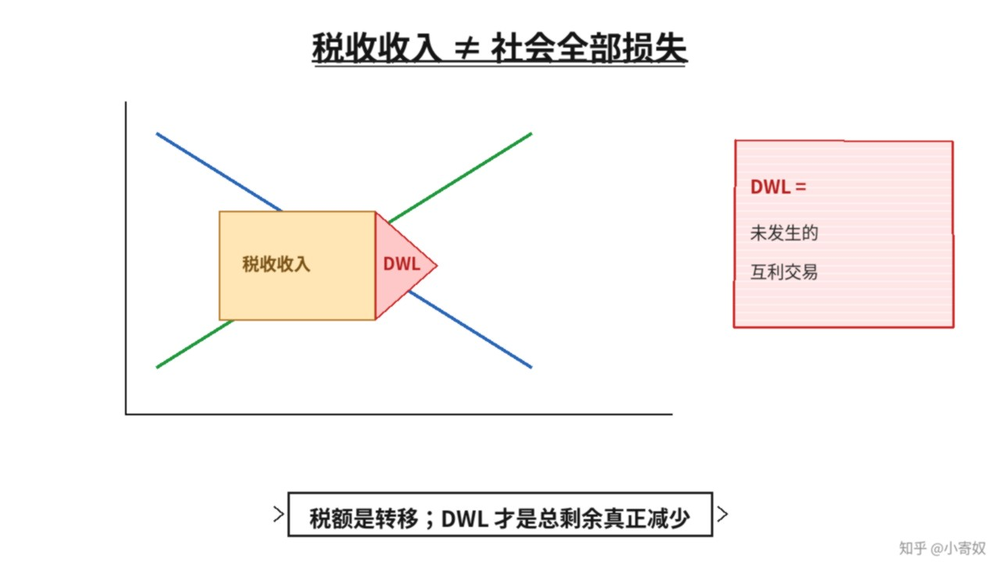

# 04｜税收与无谓损失

- 所属单元：Unit 04
- 建议用时：15 分钟
- 本节只解决：**税收收入为什么不是社会福利的全部损失？**
- 导航：[上一节](03_total_surplus_efficiency_equity.md) · [返回单元首页](README.md) · [下一节](05_elasticity_tax_revenue.md)

## 0～2 分钟：主动回忆

> 税收收入为什么不是社会福利的全部损失？

## 本节术语

| 中文术语 | English | 缩写 | 通俗解释 |
|---|---|---|---|
| 无谓损失 | Deadweight Loss | DWL | 因未实现的互利交易所造成的总剩余损失。 |
| 税收楔子 | Tax Wedge | 无通用缩写 | 买方支付价与卖方实际获得价之间的差额。 |
| 总剩余 | Total Surplus | TS | 消费者剩余与生产者剩余之和。 |

## 2～9 分钟：核心内容

税收楔子使买方支付价高于卖方所得价，交易数量下降。政府获得的税收收入仍可用于公共支出，不能把全部税额都当作社会损失。

无谓损失（Deadweight Loss, DWL）是本来能创造正总剩余、却因税收而没有发生的交易所损失的价值。图上通常是税后减少交易区间内，需求与供给之间的三角形。税率越高，楔子越大，DWL 通常以更快速度上升。

## 9～12 分钟：最小例子

某单位商品买方 WTP=90、卖方成本=70，原本创造 20 元剩余。若单位税 25 元导致交易取消，这 20 元就是 DWL 的一部分，而不是 25 元税收收入。

## 12～14 分钟：你来做

画一个供需图，标出税前均衡、买方价、卖方价、税收收入矩形和 DWL 三角形。用文字解释每块面积。

## 14～15 分钟：费曼复述

> 税收收入是 ______ 的转移；DWL 来自 ______ 的互利交易，因此是总剩余真正减少的部分。

## 适用边界

若税收纠正外部性，减少的交易可能原本带来社会损害，此时简单 DWL 图会高估损失，需加入社会成本。

## 完成证据

- [ ] 能说出本节英文术语与缩写
- [ ] 完成最小例子
- [ ] 保留了自己的判断过程
- [ ] 一句话复述与疑问已写入[工作簿](../workbook.md)
