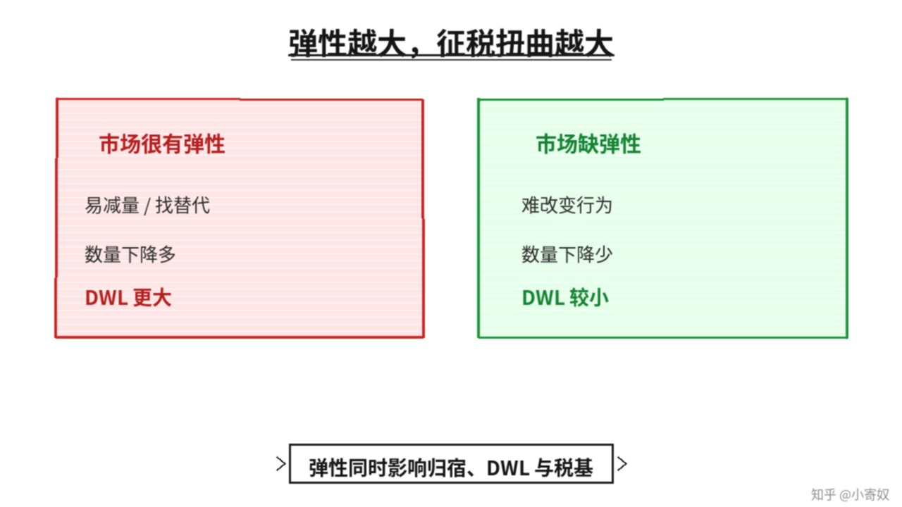

# 05｜弹性、税率与税收收入

- 所属单元：Unit 04
- 建议用时：15 分钟
- 本节只解决：**为什么对反应更灵活的市场征税，会造成更大的交易损失？**
- 导航：[上一节](04_tax_dwl.md) · [返回单元首页](README.md) · [下一节](06_world_price_trade.md)

## 0～2 分钟：主动回忆

> 为什么对反应更灵活的市场征税，会造成更大的交易损失？

## 本节术语

| 中文术语 | English | 缩写 | 通俗解释 |
|---|---|---|---|
| 需求价格弹性 | Price Elasticity of Demand | PED | 需求量对价格变化的敏感程度。 |
| 供给价格弹性 | Price Elasticity of Supply | PES | 供给量对价格变化的敏感程度。 |
| 无谓损失 | Deadweight Loss | DWL | 因未实现的互利交易所造成的总剩余损失。 |
| 总收益 | Total Revenue | TR | 销售收入，TR=P×Q。 |

## 2～9 分钟：核心内容

需求或供给越有弹性，参与者越容易减少交易、寻找替代或转移资源。相同税收楔子下，交易数量下降越多，DWL 越大。

税率提高时，单位税收增加，但税基可能缩小。税收收入并不一定随税率无限上升。弹性同时影响税负分配、DWL 和税收收入——不能只看法定税率，要看实际行为。

## 9～12 分钟：最小例子

对短期需求极缺弹性的药品征税，交易量下降较小；对替代品很多的娱乐服务征税，消费者更容易退出，数量下降和 DWL 可能更大。

## 12～14 分钟：你来做

比较对城市核心土地和跨境数字服务征税。哪一个税基更易移动？哪一个可能产生更大行为反应？说明假设。

## 14～15 分钟：费曼复述

> 市场越有弹性，征税后数量变化通常越 ______，DWL 越 ______；税收收入还取决于 ______ 的变化。

## 适用边界

税率与税收收入关系受逃税、执法、跨期调整和国际流动影响，不能仅凭一条曲线机械预测。

## 完成证据

- [ ] 能说出本节英文术语与缩写
- [ ] 完成最小例子
- [ ] 保留了自己的判断过程
- [ ] 一句话复述与疑问已写入[工作簿](../workbook.md)
