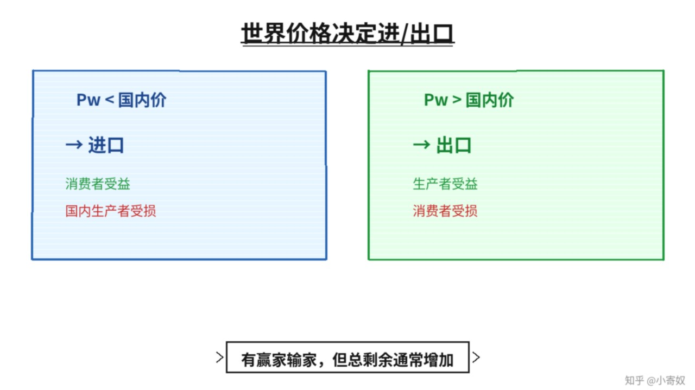

# 06｜世界价格、进口与出口

- 所属单元：Unit 04
- 建议用时：15 分钟
- 本节只解决：**开放贸易后，国内价格和不同群体福利怎样变化？**
- 导航：[上一节](05_elasticity_tax_revenue.md) · [返回单元首页](README.md) · [下一节](07_tariff_quota.md)

## 0～2 分钟：主动回忆

> 开放贸易后，国内价格和不同群体福利怎样变化？

## 本节术语

| 中文术语 | English | 缩写 | 通俗解释 |
|---|---|---|---|
| 世界价格 | World Price | Pw | 一国在国际市场上面对的商品价格。 |
| 进口 | Import | M | 从其他经济体购买的商品或服务。 |
| 出口 | Export | X | 卖给其他经济体的商品或服务。 |
| 消费者剩余 | Consumer Surplus | CS | 支付意愿减去实际支付价格。 |
| 生产者剩余 | Producer Surplus | PS | 卖方实际获得价格减去其机会成本。 |

## 2～9 分钟：核心内容

世界价格（World Price, Pw）是一国作为价格接受者面对的国际价格。国内无贸易均衡价高于 Pw → 倾向进口，国内价格下降：消费者受益、国内生产者受损。国内均衡价低于 Pw → 倾向出口，国内价格上升：生产者受益、消费者受损。

虽有赢家和输家，标准模型中赢家收益通常大于输家损失，总剩余增加。贸易收益来自比较优势和更低机会成本的全球配置。

## 9～12 分钟：最小例子

国内某零件无贸易价 100 元，世界价 70 元。开放后国内价接近 70 元，国内需求增加、供给减少，差额由进口填补。CS 增加、PS 减少，但总剩余通常增加。

## 12～14 分钟：你来做

画两种情形：Pw 低于国内价与 Pw 高于国内价。标出进口或出口数量，并写出消费者和生产者谁受益。

## 14～15 分钟：费曼复述

> 若 Pw 低于国内均衡价，国家倾向 ______；消费者剩余 ______、生产者剩余 ______。

## 适用边界

小国价格接受假设不适用于能影响世界价格的大国；运输成本、质量、汇率和供应链风险也会改变结果。

## 完成证据

- [ ] 能说出本节英文术语与缩写
- [ ] 完成最小例子
- [ ] 保留了自己的判断过程
- [ ] 一句话复述与疑问已写入[工作簿](../workbook.md)
