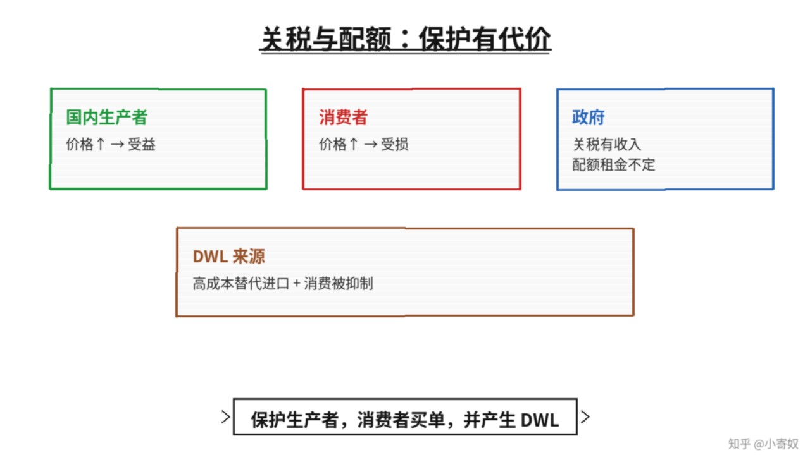

# 07｜关税、进口配额与贸易保护

- 所属单元：Unit 04
- 建议用时：15 分钟
- 本节只解决：**保护国内生产者的政策为什么会让消费者付出代价？**
- 导航：[上一节](06_world_price_trade.md) · [返回单元首页](README.md) · [下一节](08_unit_review.md)

## 0～2 分钟：主动回忆

> 保护国内生产者的政策为什么会让消费者付出代价？

## 本节术语

| 中文术语 | English | 缩写 | 通俗解释 |
|---|---|---|---|
| 关税 | Tariff | 无通用缩写 | 对进口商品征收的税。 |
| 进口配额 | Import Quota | 无通用缩写 | 对进口数量设置的上限。 |
| 无谓损失 | Deadweight Loss | DWL | 因未实现的互利交易所造成的总剩余损失。 |
| 贸易条件 | Terms of Trade | ToT | 交易中两种产品相互交换的比率。 |

## 2～9 分钟：核心内容

关税（Tariff，无通用缩写）是进口税，抬高国内价格、减少进口。国内生产者受益，政府获关税收入，但消费者支付更高价格、购买更少，总剩余通常下降。

进口配额（Import Quota，无通用缩写）直接限制进口数量，也会抬高国内价格。配额租金可能归许可证持有人或外国出口商，不一定进入政府。DWL 来自两部分：高成本国内生产替代低成本进口，以及部分高价值消费被价格抑制。

## 9～12 分钟：最小例子

世界价 70 元，关税 20 元使国内价升至 90 元。国内产量增加、消费量减少、进口缩小。消费者损失通常大于生产者收益与政府收入之和。

## 12～14 分钟：你来做

列出对进口芯片加征关税的四类影响：国内芯片厂、下游整车企业、消费者、政府。再写一个可能的动态理由与风险。

## 14～15 分钟：费曼复述

> 关税提高国内 ______，保护 ______，损害 ______，并产生 ______；配额租金不一定归政府。

## 适用边界

幼稚产业、国家安全和供应链韧性是动态论据，但需要证明保护能形成长期能力且不会永久固化低效率。

## 完成证据

- [ ] 能说出本节英文术语与缩写
- [ ] 完成最小例子
- [ ] 保留了自己的判断过程
- [ ] 一句话复述与疑问已写入[工作簿](../workbook.md)
