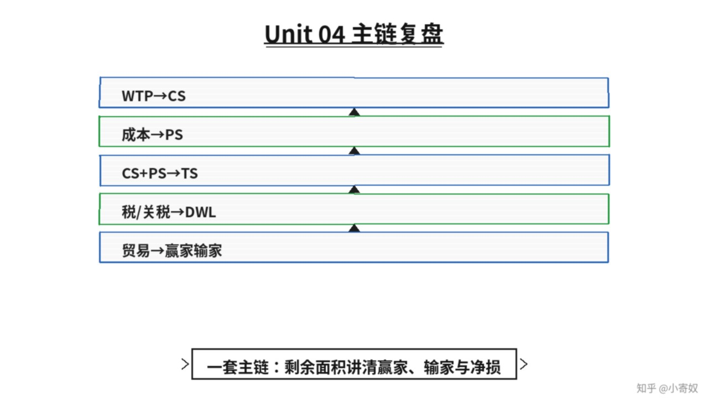

# 08｜单元复盘：福利、税收与贸易

- 所属单元：Unit 04
- 建议用时：15 分钟
- 本节只解决：**能否用剩余面积解释一项税收或贸易政策的赢家、输家与净效果？**
- 导航：[上一节](07_tariff_quota.md) · [返回单元首页](README.md)

## 0～2 分钟：主动回忆

> 能否用剩余面积解释一项税收或贸易政策的赢家、输家与净效果？

## 本节术语（复用）

| 中文术语 | English | 缩写 |
|---|---|---|
| 消费者剩余 | Consumer Surplus | CS |
| 生产者剩余 | Producer Surplus | PS |
| 总剩余 | Total Surplus | TS |
| 无谓损失 | Deadweight Loss | DWL |

## 2～9 分钟：核心内容

闭卷回忆这一条主线（**一套流程，不要另起平行方案**）：



```text
WTP → CS
卖方成本 → PS
CS+PS → TS
税收/关税 → 数量下降与再分配 → DWL
开放贸易 → 赢家与输家 → TS 变化
```

分析任何政策至少回答：谁的价格改变？交易数量怎样变？CS、PS、政府收入分别怎样？有没有被取消的互利交易？效果是效率判断还是公平判断？

## 9～12 分钟：最小例子

进口关税同时提高国内 PS 和政府收入，但 CS 下降更多，差额形成 DWL。若政策目标是安全，还需把安全收益明确加入 CBA，而不能只说「保护产业」。

## 12～14 分钟：你来做

10 分钟内：①算一组 CS/PS；②画税收收入和 DWL；③分析开放贸易；④比较关税与配额；⑤用 1 分钟讲清效率与公平。

## 14～15 分钟：费曼复述

> 福利分析通过 ______、______ 和 ______ 把赢家、输家与净损失分开。

## 适用边界

剩余分析依赖价格能反映私人价值与成本。外部性、信息问题和收入分配价值需在下一单元补充。

## 完成证据

- [ ] 能说出本节英文术语与缩写
- [ ] 完成最小例子
- [ ] 保留了自己的判断过程
- [ ] 一句话复述与疑问已写入[工作簿](../workbook.md)
