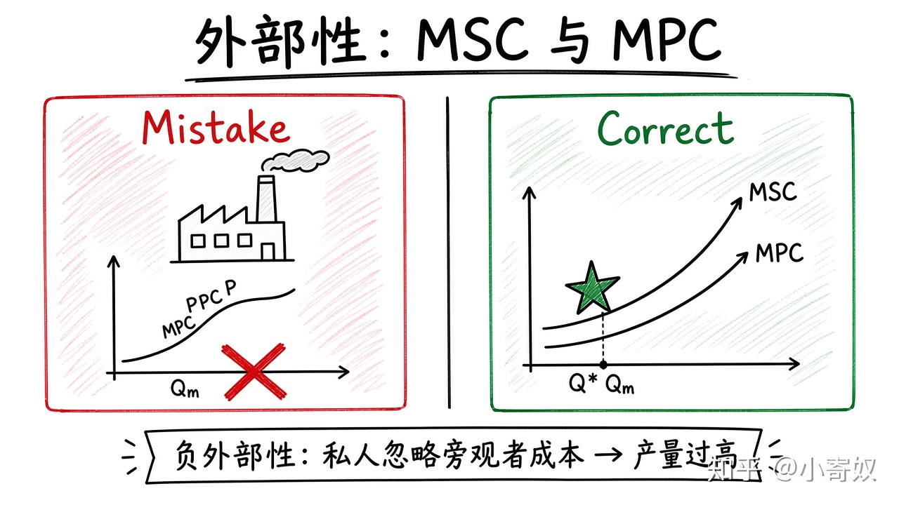

# 01｜外部性与私人、社会边际量

- 所属单元：Unit 05
- 建议用时：15 分钟
- 本节只解决：**市场价格没有包含对旁观者的影响时，为什么均衡会偏离社会最优？**
- 导航：[返回单元首页](README.md) · [下一节](02_pigouvian_tax.md)

## 0～2 分钟：主动回忆

> 市场价格没有包含对旁观者的影响时，为什么均衡会偏离社会最优？

## 本节术语

| 中文术语 | English | 缩写 | 通俗解释 |
|---|---|---|---|
| 外部性 | Externality | 无通用缩写 | 一个人的行为影响旁观者福利，但这种影响未完全进入市场价格。 |
| 私人边际成本 | Marginal Private Cost | MPC | 决策者自己承担的再生产一单位的成本。 |
| 社会边际成本 | Marginal Social Cost | MSC | 私人边际成本加上对外部主体造成的边际损害。 |
| 私人边际收益 | Marginal Private Benefit | MPB | 决策者自己获得的再消费一单位的收益。 |
| 社会边际收益 | Marginal Social Benefit | MSB | 私人边际收益加上给外部主体带来的边际收益。 |

> 第一次出现记住「中文（English, 缩写）」；无公认缩写就写「无通用缩写」，不要自造。

## 2～9 分钟：核心内容

外部性（Externality，无通用缩写）是行为影响旁观者福利，却未完全进入交易价格。

负外部性：社会边际成本（Marginal Social Cost, MSC）= 私人边际成本（Marginal Private Cost, MPC）+ 边际外部损害。正外部性：社会边际收益（Marginal Social Benefit, MSB）= 私人边际收益（Marginal Private Benefit, MPB）+ 边际外部收益。

市场只按 MPC 或 MPB 决策 → 负外部性时常产量过高，正外部性时常产量过低。固定顺序：识别旁观者 → 判断损/益 → 比较私人与社会边际量 → 判断偏离方向。

## 9～12 分钟：最小例子

电池工厂只算原料与工资，未计入居民健康损失 → MPC<MSC，价格偏低、产量偏高。

## 12～14 分钟：你来做

分别写出污染工厂与疫苗接种的边际关系，并判断市场产量相对社会最优过高还是过低。

## 14～15 分钟：费曼复述

> 负外部性时 MSC ______ MPC，市场产量通常 ______；正外部性时 MSB ______ MPB，市场产量通常 ______。

## 适用边界

外部损害或收益需估计，且随地点、时间、人群变化；不能只凭「有人受影响」就定政策。

## 完成证据

- [ ] 能说出本节英文术语与缩写
- [ ] 完成最小例子
- [ ] 保留了自己的判断过程
- [ ] 一句话复述与疑问已写入[工作簿](../workbook.md)
