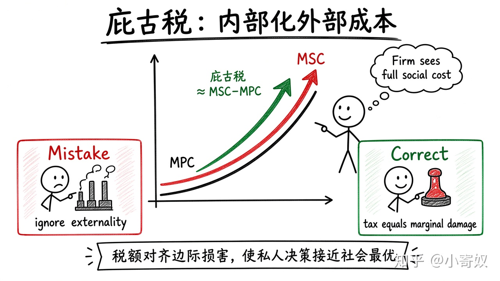

# 02｜庇古税与外部成本内部化

- 所属单元：Unit 05
- 建议用时：15 分钟
- 本节只解决：**怎样让污染者在决策时看到原本由社会承担的成本？**
- 导航：[上一节](01_externality_social_private.md) · [返回单元首页](README.md) · [下一节](03_subsidy_tradable_permits.md)

## 0～2 分钟：主动回忆

> 怎样让污染者在决策时看到原本由社会承担的成本？

## 本节术语

| 中文术语 | English | 缩写 | 通俗解释 |
|---|---|---|---|
| 庇古税 | Pigouvian Tax | 无通用缩写 | 按外部损害设置、使决策者内部化外部成本的税。 |
| 社会边际成本 | Marginal Social Cost | MSC | 私人边际成本加上对外部主体造成的边际损害。 |
| 私人边际成本 | Marginal Private Cost | MPC | 决策者自己承担的再生产一单位的成本。 |
| 无谓损失 | Deadweight Loss | DWL | 未实现的互利交易所造成的总剩余损失。 |

> 第一次出现记住「中文（English, 缩写）」；无公认缩写就写「无通用缩写」，不要自造。

## 2～9 分钟：核心内容

庇古税（Pigouvian Tax，无通用缩写）按边际外部损害设置，使企业面对的成本接近 MSC。理想税额 ≈ MSC−MPC，即把价格外的社会成本「内部化」。

与普通扭曲税不同：合适的庇古税减少的是社会成本大于社会收益的交易，可能提高总福利。难点是测量损害并随地点、时间、技术调整税率。

## 9～12 分钟：最小例子

若每块电池边际污染损害约 20 元，单位庇古税 20 元可使产量向社会最优下降。

## 12～14 分钟：你来做

比较固定排放标准与单位排污税：企业减排成本不同时，哪种更能让低成本企业多减排？为什么？

## 14～15 分钟：费曼复述

> 庇古税的目标不是单纯筹资，而是让 ______ 进入私人决策，使 MPC 接近 ______。

## 适用边界

若损害有阈值、不可逆风险或测量极不可靠，数量标准可能比价格工具更合适。

## 完成证据

- [ ] 能说出本节英文术语与缩写
- [ ] 完成最小例子
- [ ] 保留了自己的判断过程
- [ ] 一句话复述与疑问已写入[工作簿](../workbook.md)
