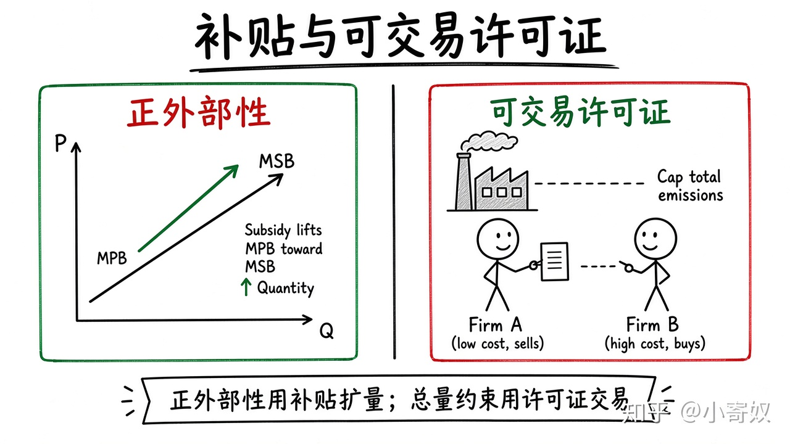

# 03｜补贴与可交易许可证

- 所属单元：Unit 05
- 建议用时：15 分钟
- 本节只解决：**正外部性和总量污染约束分别适合什么政策工具？**
- 导航：[上一节](02_pigouvian_tax.md) · [返回单元首页](README.md) · [下一节](04_coase_transaction_cost.md)

## 0～2 分钟：主动回忆

> 正外部性和总量污染约束分别适合什么政策工具？

## 本节术语

| 中文术语 | English | 缩写 | 通俗解释 |
|---|---|---|---|
| 私人边际收益 | Marginal Private Benefit | MPB | 决策者自己获得的再消费一单位的收益。 |
| 社会边际收益 | Marginal Social Benefit | MSB | 私人边际收益加上给外部主体带来的边际收益。 |
| 可交易许可证 | Tradable Permit | 无通用缩写 | 可买卖的排放或资源使用权。 |
| 机会成本 | Opportunity Cost | OC | 作出选择时，最佳被放弃方案的价值。 |

> 第一次出现记住「中文（English, 缩写）」；无公认缩写就写「无通用缩写」，不要自造。

## 2～9 分钟：核心内容

正外部性使 MPB<MSB，市场数量不足。补贴可提高私人收益或降低私人成本，使行为接近社会最优（如教育、基础研究、疫苗）。

可交易许可证（Tradable Permit，无通用缩写）先定总量，再让许可证交易：低成本者多减排并卖证，高成本者买证。税是「定价格、让数量调」；许可证是「定数量、让价格调」。不确定性决定两者优劣。

## 9～12 分钟：最小例子

城市发放 1000 吨排放许可证。A 减排成本低则减排并卖证；B 成本高则买证。总排放受控，任务流向机会成本低者。

## 12～14 分钟：你来做

为「自动驾驶公共道路测试数据共享」写一个正外部性补贴思路，并说明可能被怎样套利。

## 14～15 分钟：费曼复述

> 正外部性通常使市场数量 ______，补贴可提高私人 ______；许可证固定 ______，交易决定价格。

## 适用边界

补贴需识别真正外部收益，防止把私人收益包装成公共收益；许可证依赖监测与执法。

## 完成证据

- [ ] 能说出本节英文术语与缩写
- [ ] 完成最小例子
- [ ] 保留了自己的判断过程
- [ ] 一句话复述与疑问已写入[工作簿](../workbook.md)
