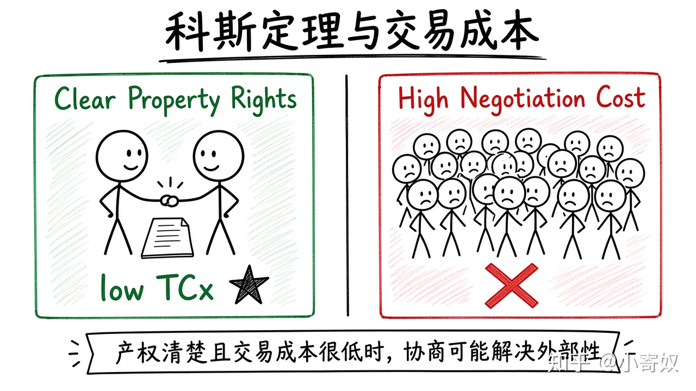

# 04｜科斯定理、产权与交易成本

- 所属单元：Unit 05
- 建议用时：15 分钟
- 本节只解决：**政府不直接规定结果时，私人协商为什么有时也能解决外部性？**
- 导航：[上一节](03_subsidy_tradable_permits.md) · [返回单元首页](README.md) · [下一节](05_goods_classification.md)

## 0～2 分钟：主动回忆

> 政府不直接规定结果时，私人协商为什么有时也能解决外部性？

## 本节术语

| 中文术语 | English | 缩写 | 通俗解释 |
|---|---|---|---|
| 科斯定理 | Coase Theorem | 无通用缩写 | 产权清楚且交易成本很低时，私人协商可能解决外部性。 |
| 交易成本 | Transaction Cost | TCx | 寻找信息、谈判、签约和执行协议所付出的成本。TCx 为本课程避免与总成本 TC 混淆采用的记号。 |
| 外部性 | Externality | 无通用缩写 | 一个人的行为影响旁观者福利，但这种影响未完全进入市场价格。 |

> 第一次出现记住「中文（English, 缩写）」；无公认缩写就写「无通用缩写」，不要自造。

## 2～9 分钟：核心内容

科斯定理（Coase Theorem，无通用缩写）：产权清楚、参与者少、交易成本很低时，私人协商可能把资源配到高价值用途；初始产权主要影响分配，不一定改变效率结果。

交易成本（Transaction Cost, TCx）含信息、谈判、签约、监督与执行。受害者众多、损害难测、搭便车或力量不对称时，TCx 很高，协商难成。科斯提醒先问：产权是否明确？协商为何失败？怎样降低 TCx？

## 9～12 分钟：最小例子

相邻两公司，噪声影响清楚且只有双方时，可能通过补偿选低成本方案；若受影响居民十万，谈判极难。

## 12～14 分钟：你来做

选一个停车噪声、数据共享或小区公共空间案例，列出产权、参与者、谈判成本和阻碍因素。

## 14～15 分钟：费曼复述

> 科斯定理成立依赖产权 ______、参与者可协商、交易成本 ______；初始产权影响 ______。

## 适用边界

权力不对等、不可撤销损害与基本权利问题不能简单按支付能力协商；效率不是唯一价值。

## 完成证据

- [ ] 能说出本节英文术语与缩写
- [ ] 完成最小例子
- [ ] 保留了自己的判断过程
- [ ] 一句话复述与疑问已写入[工作簿](../workbook.md)
